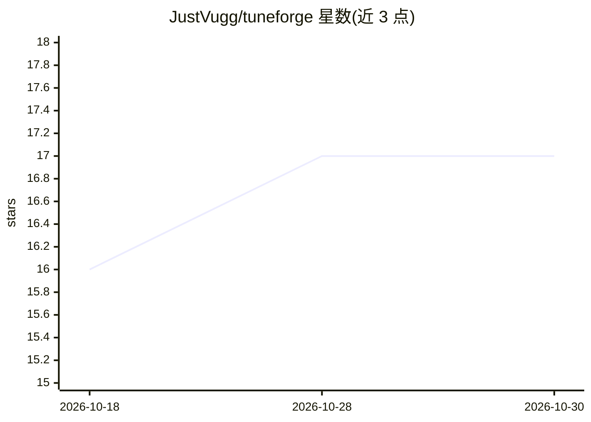

# JustVugg/tuneforge

⭐ 17 · Python · MIT · 推送 2026-04-21 · [GitHub](https://github.com/JustVugg/tuneforge) · 个人维护

**MCP 服务器：让编码 agent 直接生成数据集、微调与评测 LLM**

面向 MCP 兼容编码 agent（Claude Desktop、Claude Code、Cursor 等）的 MCP 服务器，暴露 12 个工具：从产品描述生成 SFT 数据集（含 LLM-judge 质量过滤）、在 Hugging Face 因果 LM 上做 LoRA SFT、REINFORCE 式 RL（默认 Ollama 托管模型作 judge）、合并适配器与留出集评测。长任务以 SQLite 状态的后台作业调度，工具调用即返回 job_id 供 agent 轮询；默认 4-bit 量化支持 16GB 消费级 GPU 训练 7B。同一操作另提供 Typer CLI。声明非 Unsloth/TRL 替代、无多租户与 UI，数据生成与 RL 需要教师模型（建议 7B+）。

## 筛选速览

| 维度 | 判定 | 备注 |
|---|---|---|
| AI 角色 | `ai-ecosystem` | LLM/agent 周边工具 |
| 许可风险 | `permissive` | MIT |
| 部署形态 | `library` | 以包/库形式分发 |
| 模型依赖 | local-ok | 支持本地模型 |
| 硬件要求 | — | 无带数字的原话,不猜 |
| 安装摩擦 | `medium` | 含编译或系统依赖之一 |
| 成熟度 | — | 结构信号不足 |

## 能力要点

- 数据生成→LoRA SFT→RL→合并→评测全流程经 MCP 工具驱动
- 长任务后台作业化（SQLite 状态存储），传输层不阻塞
- 训练前经 safetensors 元数据与 torch.cuda.mem_get_info 做 VRAM 预检
- 默认 4-bit 量化与 Ollama 本地 judge，无需 API key

## 适用场景

- 在编码 agent 对话中完成小模型微调与评测闭环
- 从 FAQ/产品描述生成指令数据集并训练问答模型
- 以脚本/CI 方式用 tuneforge-cli 复现训练与评测流程

## 场景标签

`微调` `强化学习` `模型评测` · 领域:评测与运维

## 证据(README 行号)

> L3: **An MCP server that lets coding agents generate datasets, fine-tune, and evaluate LLMs — without leaving the chat.*
> L5: TuneForge exposes a small, sharp set of tools over the Model Context Protocol so any MCP-capable agent (Claude Deskt
> L44: |Tool|Purpose|Blocking?|

## 星数曲线

2026-10-18 16 → 2026-10-30 17（+1）

---
*卡片 v1 · prompt 1.4 · 生成 2026-10-30 · 置信度 high · 依据 README sha `6cc4b9f2d1ed` · [字段定义](../../DATASET.md)*
