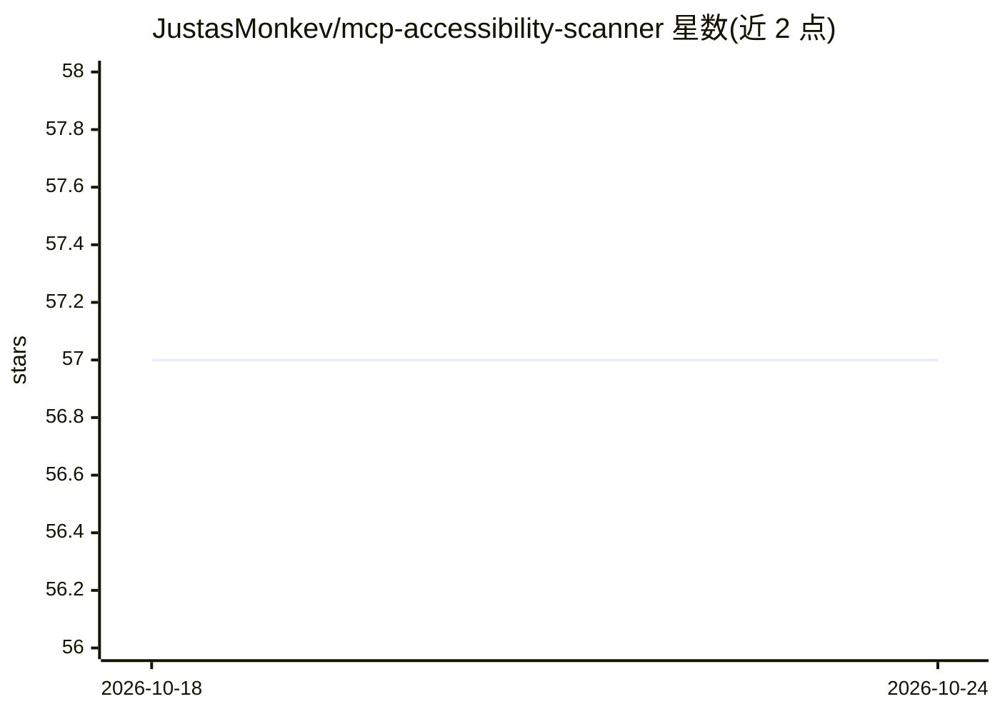

# JustasMonkev/mcp-accessibility-scanner

⭐ 57 · TypeScript · MIT · 推送 2026-10-21 · [GitHub](https://github.com/JustasMonkev/mcp-accessibility-scanner) · [官网](https://www.npmjs.com/package/mcp-accessibility-scanner) · 个人维护

**供编码 Agent 调用的网页无障碍审计 MCP 服务器**

基于 MCP 协议的 stdio 服务器，让 Claude Desktop、Claude Code、VS Code 等编码 Agent 在浏览器中执行 axe-core 无障碍扫描、键盘焦点审计与屏幕阅读器可访问性树检查，保存 JSON 报告与带标注截图。同时提供浏览器自动化工具（点击、输入、截图、网络监控）。限制：自动化检查不证明 WCAG 合规，不使用真实屏幕阅读器；scan_page 不保存 JSON 报告，无 HTML 报告面板。安装需系统 Chrome，npm 全局安装需 --allow-scripts=re2，另有含 Chromium 的 Docker 镜像与交互式 REPL。

## 筛选速览

| 维度 | 判定 | 备注 |
|---|---|---|
| AI 角色 | `ai-ecosystem` | LLM/agent 周边工具 |
| 许可风险 | `permissive` | MIT |
| 部署形态 | `self-host` | docker 或自建部署 |
| 模型依赖 | — | README 未给出锁定关系 |
| 硬件要求 | — | 无带数字的原话,不猜 |
| 安装摩擦 | `low` | 无编译、无系统依赖或容器化 |
| 成熟度 | — | 结构信号不足 |

## 能力要点

- scan_page 运行 axe 检查并生成带违规标注的整页截图
- audit_keyboard 键盘 Tab 焦点审计与 audit_screen_reader 可访问性树检查
- 覆盖 WCAG 2.0/2.1/2.2（A/AA/AAA）的自动检查与修复指引链接
- stdio MCP 服务器模式、交互式 REPL 与浏览器扩展三种运行方式

## 适用场景

- 在编码 Agent 中对本地开发的页面跑无障碍审计
- 迭代开发时生成可复查的 JSON 审计报告与标注截图
- 在终端用 REPL 手动执行扫描工具

## 场景标签

`浏览器自动化` `代码审查` · 领域:效率与自动化

## 证据(README 行号)

> L3: Accessibility checks inside your coding agent: axe scans, keyboard-focus checks and repeatable reports.
> L9: This MCP server lets your coding agent inspect a page, run axe checks, exercise keyboard focus and save findings for
> L153: When launched without a subcommand, the process starts an MCP server that communicates over stdio. This is the mod

## 星数曲线

2026-10-18 57 → 2026-10-24 57（+0）

---
*卡片 v1 · prompt 1.4 · 生成 2026-10-24 · 置信度 high · 依据 README sha `6a4d4b4ae3d5` · [字段定义](../../DATASET.md)*
