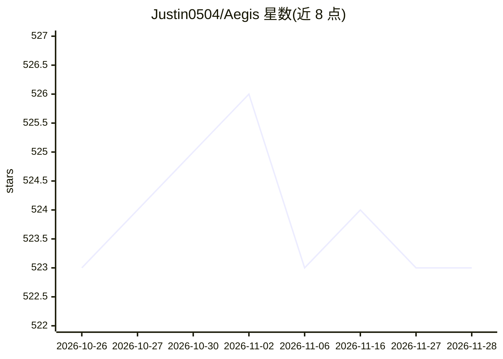

# Justin0504/Aegis

⭐ 523 · TypeScript · MIT · 推送 2026-10-31 · [GitHub](https://github.com/Justin0504/Aegis) · [官网](https://aegistraces.com) · 个人维护

**为 AI agent 提供执行前策略拦截与审计的安全网关**

AEGIS 是一个 agent 运行时策略执行层：以网关加 SDK 形式部署在 agent 与其工具之间，对每次工具调用在执行前分类、检查策略、拦截违规，并写入防篡改审计日志；支持人工审批、kill switch，声称一行代码接入且无需修改 agent 本体。附带 Compliance Cockpit 仪表盘，提供活动时间线、审批证据、违规清单、Security 360 覆盖等七个视图。桌面安装包覆盖 macOS 与 Linux（Windows 标注 coming soon），也可经云平台一键部署或 docker compose 本地运行。

## 筛选速览

| 维度 | 判定 | 备注 |
|---|---|---|
| AI 角色 | `ai-ecosystem` | LLM/agent 周边工具 |
| 许可风险 | `permissive` | MIT |
| 部署形态 | `desktop` | 安装包/桌面程序 |
| 模型依赖 | — | README 未给出锁定关系 |
| 硬件要求 | — | 无带数字的原话,不猜 |
| 安装摩擦 | `low` | 无编译、无系统依赖或容器化 |
| 成熟度 | — | 结构信号不足 |

## 能力要点

- 执行前拦截：分类每次工具调用、强制策略、阻断违规并写防篡改审计日志
- 人工审批（human-in-the-loop）与 Ed25519 签名的 decision receipt 验证
- MCP 工具钉扎与 LLM egress 代理（OpenAI/Anthropic 通道）
- 声明 10 战术 × 40 技术的 agent 威胁本体与 Detector 插件契约

## 适用场景

- 阻止 agent 执行 SQL 注入、数据外传等危险工具调用
- 高风险操作（如删除类命令）挂起等待人工批准
- 对接 Splunk/Datadog 等 SIEM 汇集 agent 审计事件
- 审计团队核查 agent 读取过的上下文与调用证据

## 场景标签

`网络安全` · 领域:学习与行业

## 证据(README 行号)

> L58: > AEGIS is the missing layer: a **pre-execution firewall** that sits between your agent and its tools, classifies e
> L148: |**Gateway API**|localhost:8080|Policy engine — classifies, checks, blocks|

## 星数曲线

2026-10-26 523 → 2026-11-28 523（+0）

---
*卡片 v1 · prompt 1.4 · 生成 2026-11-25 · 置信度 mid · 依据 README sha `1c8b4e41d20a` · [字段定义](../../DATASET.md)*
