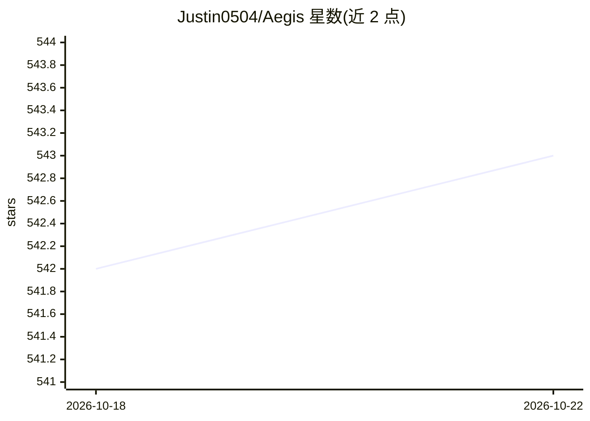

# Justin0504/Aegis

⭐ 523 · TypeScript · MIT · 推送 2026-10-09 · [GitHub](https://github.com/Justin0504/Aegis) · [官网](https://aegistraces.com) · 个人维护

**AI agent 的预执行防火墙：拦截、审计并管控每个工具调用**

部署在 agent 与其工具之间的网关层：每次工具调用先经 5 级流水线（分类、异常检测、JSON-Schema 策略评估、租户 DSL 规则、最严信号裁决），输出放行/人工审批/阻断，并写入防篡改审计日志（RFC 6962 Merkle 树 + 离线包含证明）。提供 Compliance Cockpit 六视图仪表盘、agent 注册身份、预算护栏、LLM 出口代理、SIEM 下沉与合规证据包。Python/TS/Go SDK 一行接入，支持 Docker Compose、Render/Railway/DO 一键部署及 macOS/Linux 桌面构建（Windows 未发布）。

## 筛选速览

| 维度 | 判定 | 备注 |
|---|---|---|
| AI 角色 | `ai-ecosystem` | LLM/agent 周边工具 |
| 许可风险 | `permissive` | MIT |
| 部署形态 | `desktop` | 安装包/桌面程序 |
| 模型依赖 | — | README 未给出锁定关系 |
| 硬件要求 | — | 无带数字的原话,不猜 |
| 安装摩擦 | `low` | 无编译、无系统依赖或容器化 |
| 成熟度 | — | 结构信号不足 |

## 能力要点

- 预执行阻断：工具调用在执行前经 5 级流水线分类与策略裁决
- RFC 6962 透明日志，审计事件可离线验证
- agent 身份注册、工具范围声明、预算护栏与人工审批流
- 10 战术 × 40 技术的 Agent 威胁本体（AAT-T*）与覆盖图

## 适用场景

- 阻止 agent 执行危险 SQL、shell 命令或数据外泄
- 合规团队按 SOC 2 / ISO 27001 / EU AI Act 取证审计 agent 行为
- 对高风险操作引入 human-in-the-loop 审批

## 场景标签

`网络安全` `LLM 可观测性` · 领域:评测与运维

## 证据(README 行号)

> L58: > AEGIS is the missing layer: a **pre-execution firewall** that sits between your agent and its tools, classifies e
> L213: call goes to the AEGIS Gateway before it goes to the tool. The gateway
> L215: pauses for human review, or blocks it. Every allowed call lands in a

## 星数曲线

2026-10-18 542 → 2026-10-22 543（+1）

---
*卡片 v1 · prompt 1.4 · 生成 2026-10-21 · 置信度 mid · 依据 README sha `88cec36a5e3d` · [字段定义](../../DATASET.md)*
