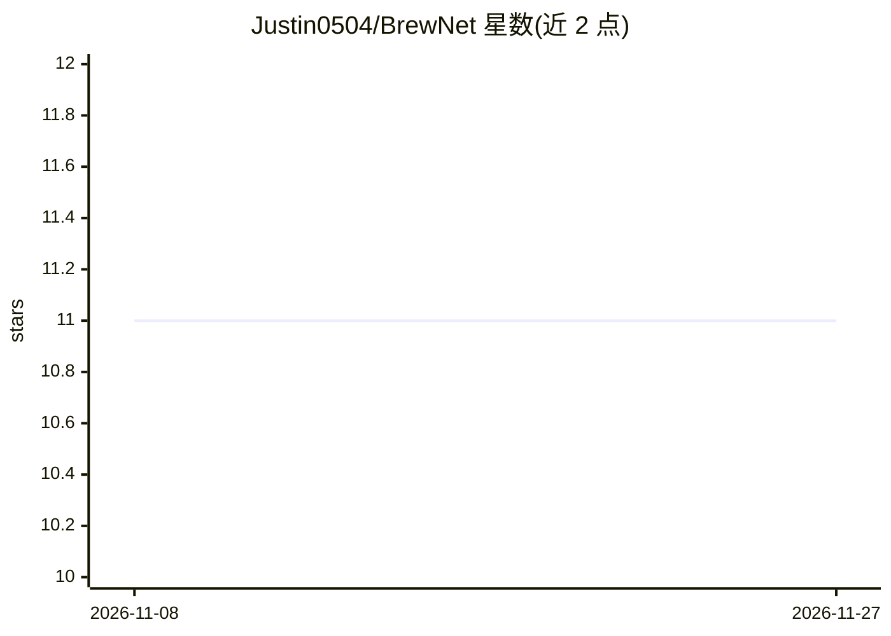

# Justin0504/BrewNet

⭐ 11 · Swift · 推送 2026-08-11 · [GitHub](https://github.com/Justin0504/BrewNet) · [官网](https://brewnet.gt.tc/) · 个人维护 · 中文 README

**面向职场人士的 AI 推荐咖啡社交 iOS 应用**

BrewNet 是一款 iOS 职业社交应用，通过双塔神经网络对用户资料做特征提取与余弦相似度计算，生成推荐匹配；匹配成功后可发送咖啡见面邀请并加入日程，支持卡片式滑动交互、实时聊天与在线状态。后端采用 Supabase（PostgreSQL、实时订阅、对象存储、认证），支付使用 StoreKit 2 订阅。提供免费与 Pro 会员两级功能，含资料可见性控制、位置模糊化与举报拉黑。运行需 macOS 14+、Xcode 15+，配置 Supabase 后在 Xcode 中运行。

## 筛选速览

| 维度 | 判定 | 备注 |
|---|---|---|
| AI 角色 | `ai-native` | 本体是模型或模型工具 |
| 许可风险 | `none` | — |
| 部署形态 | `None` |  |
| 模型依赖 | — | README 未给出锁定关系 |
| 硬件要求 | — | 无带数字的原话,不猜 |
| 安装摩擦 | `medium` | 含编译或系统依赖之一 |
| 成熟度 | — | 结构信号不足 |

## 能力要点

- 双塔神经网络推荐算法（Two-Tower Encoder + 余弦相似度）
- 咖啡约会邀请系统与实时聊天
- 基于 Supabase 的后端（PostgreSQL/RLS/实时订阅/对象存储）
- StoreKit 2 订阅与 Pro 会员体系

## 适用场景

- 寻找职业人脉并发起线下咖啡见面
- 通过滑动匹配结识同领域职场人士
- 自托管学习 Supabase + SwiftUI 的完整社交应用实现

## 场景标签

`推荐系统` · 领域:学习与行业

## 证据(README 行号)

> L13: BrewNet 是一款基于 AI 智能推荐的专业社交应用，帮助职场人士通过"咖啡聊天"的方式建立真实、有价值的职业人脉。
> L109: - **Two-Tower Encoder** - 双塔推荐算法
> L129: 用户资料 → AI 特征提取 → 相似度计算 → 个性化推荐

## 星数曲线

2026-11-08 11 → 2026-11-27 11（+0）

---
*卡片 v1 · prompt 1.4 · 生成 2026-11-19 · 置信度 high · 依据 README sha `ff9e529c23c5` · [字段定义](../../DATASET.md)*
