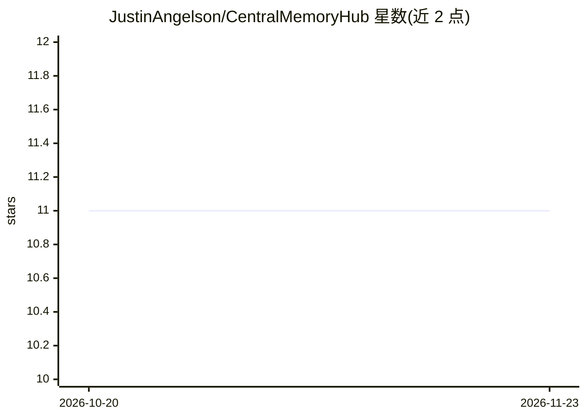

# JustinAngelson/CentralMemoryHub

⭐ 11 · Python · Apache-2.0 · 推送 2026-10-20 · [GitHub](https://github.com/JustinAngelson/CentralMemoryHub) · [官网](https://CentralMemoryHub.com) · 个人维护

**为多智能体系统提供厂商中立共享记忆的持久层（MCP+REST）**

CMH 是面向多智能体系统的组织级共享记忆持久层，通过 Web UI、REST API 与 MCP 服务器三种途径同时访问。功能覆盖五大块：语义/结构化记忆存储与检索、AI 智能体目录（含层级树与会话跟踪）、技能注册表、资源目录、决策日志与知识索引等审计信息。嵌入依赖 OpenAI、向量存储依赖 Pinecone，需自备 PostgreSQL 与 Python 3.11+。注册采用邀请制，具备基于角色的访问控制与 API key 管理。

## 筛选速览

| 维度 | 判定 | 备注 |
|---|---|---|
| AI 角色 | `ai-ecosystem` | LLM/agent 周边工具 |
| 许可风险 | `permissive` | Apache-2.0 |
| 部署形态 | `None` |  |
| 模型依赖 | locked-api |  |
| 硬件要求 | — | 无带数字的原话,不猜 |
| 安装摩擦 | `low` | 无编译、无系统依赖或容器化 |
| 成熟度 | — | 结构信号不足 |

## 能力要点

- 同时提供 REST API 与 MCP server，两类客户端共享同一记忆
- 31 个 MCP 工具覆盖记忆、组织状态、智能体与任务管理
- 智能体目录含汇报层级树、跨会话智能体间消息与技能注册表
- 邀请制注册、角色访问控制与 API key 限流等安全机制

## 适用场景

- 让多个不同平台的智能体共享同一份组织记忆
- 为团队内的 AI 智能体建立目录、层级与会话跟踪
- 记录 AI 参与的决策与知识索引以便审计
- 通过 Claude.ai、Cursor 等 MCP 客户端接入共享记忆

## 场景标签

`多智能体` `Agent 记忆` · 领域:Agent 开发

## 证据(README 行号)

> L19: CMH is the persistence layer that fills that gap.
> L31: CMH is organized around five functional areas, accessible through a web UI, a REST API, and a full MCP server simul
> L75: Two integration paths — both reading from and writing to the same underlying database:

## 星数曲线

2026-10-20 11 → 2026-11-23 11（+0）

---
*卡片 v1 · prompt 1.4 · 生成 2026-11-19 · 置信度 high · 依据 README sha `a05f01ac00ef` · [字段定义](../../DATASET.md)*
