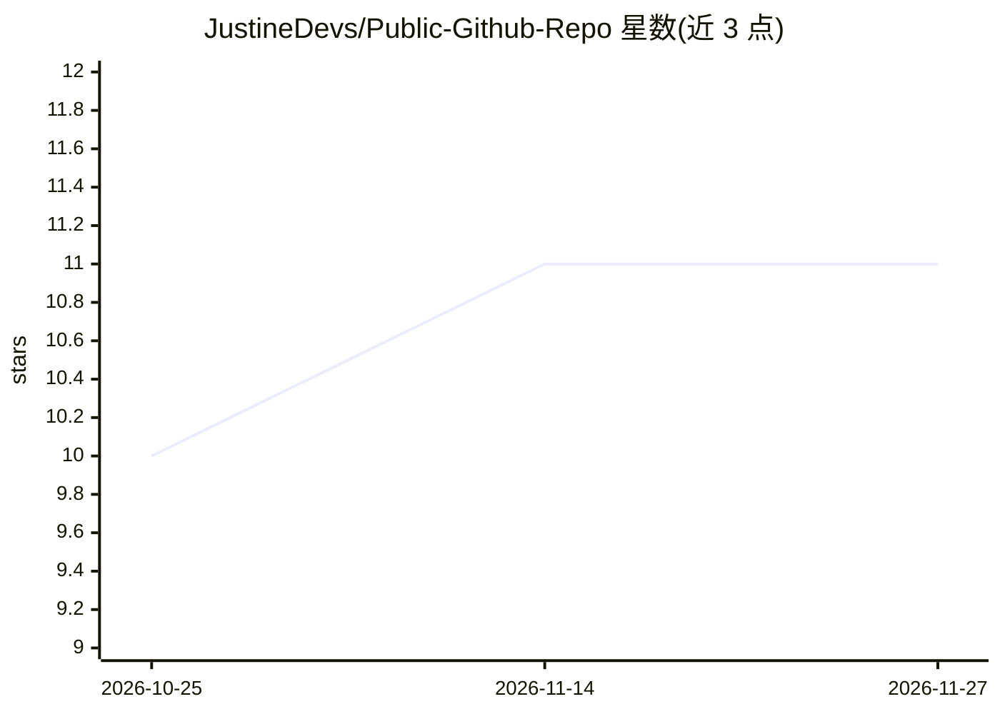

# JustineDevs/Public-Github-Repo

⭐ 11 · JavaScript · NOASSERTION · 推送 2026-08-26 · [GitHub](https://github.com/JustineDevs/Public-Github-Repo) · 个人维护

**为开发者收录 AI/LLM 相关仓库与学习资源的清单**

面向开发者的仓库收藏清单，按 AI 与机器学习、学习资源、工具与库、Web 服务、UI/UX 设计工具等类别组织条目，收录 MCP 教程、prompt 工程、Claude agent 示例与各类专家 agent 模板等资源；提供 npm 运行的自动化并行提交脚本辅助仓库维护，社区可通过 issue 或 pull request 提交新条目，采用 MIT 许可。

## 筛选速览

| 维度 | 判定 | 备注 |
|---|---|---|
| AI 角色 | `ai-knowledge` | 知识聚合/清单类 |
| 许可风险 | `none` | NOASSERTION |
| 部署形态 | `None` |  |
| 模型依赖 | — | README 未给出锁定关系 |
| 硬件要求 | — | 无带数字的原话,不猜 |
| 安装摩擦 | `low` | 无编译、无系统依赖或容器化 |
| 成熟度 | — | 结构信号不足 |

## 能力要点

- 按 AI/学习资源/工具库/Web 服务/UI-UX 五类组织仓库条目
- 收录 MCP 教程、prompt 工程与 Claude agent 示例模板
- 提供自动化并行提交脚本（npm run commit:dry 等）
- 接受 issue/PR 方式的社区贡献

## 适用场景

- 查找 AI 与 LLM 开发相关的工具与学习资源
- 获取 prompt 模板与 agent 示例用于 AI 开发
- 作为贡献者向清单提交新仓库

## 场景标签

`精选清单` · 领域:学习与行业

## 证据(README 行号)

> L3: A curated collection of helpful repositories for developers, featuring resources on AI, Large Language Models (LLMs)
> L26: ## 🚀 Featured Repositories
> L30: - **🤖 AI & Machine Learning** - Core AI models, frameworks, and applications

## 星数曲线

2026-10-25 10 → 2026-11-27 11（+1）

---
*卡片 v1 · prompt 1.4 · 生成 2026-11-19 · 置信度 high · 依据 README sha `9d4e2443b5a2` · [字段定义](../../DATASET.md)*
