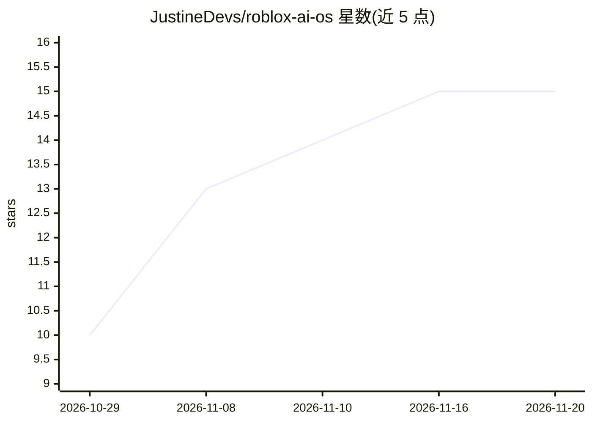

# JustineDevs/roblox-ai-os

⭐ 15 · Lua · 推送 2026-05-12 · [GitHub](https://github.com/JustineDevs/roblox-ai-os) · [官网](https://buymeacoffee.com/justinedevs) · 个人维护

**给 Roblox 创作者提供的 Codex CLI 工作流与运行时层**

RCS 是构建在 OpenAI Codex CLI 之上的 Roblox Studio 工作流层，把简报、蓝图、执行、审查、验证组织为 $brief/$blueprint/$forge/$crew/$autoforge 等命令，并提供玩家心理感知的设计命令与强制前置检查门槛。通过 npm 全局安装并运行 rcs setup 安装技能、提示词、hooks 与 .rcs/ 状态目录；Codex 为执行引擎，RCS 提供角色关键词、技能与运行时状态。Tier 1 路径为 macOS/Linux + Codex CLI，Windows 与 Codex App 非默认路径且支持较少；Cursor/MCP 编辑器为参考文档交付。

## 筛选速览

| 维度 | 判定 | 备注 |
|---|---|---|
| AI 角色 | `ai-ecosystem` | LLM/agent 周边工具 |
| 许可风险 | `none` | — |
| 部署形态 | `library` | 以包/库形式分发 |
| 模型依赖 | — | README 未给出锁定关系 |
| 硬件要求 | — | 无带数字的原话,不猜 |
| 安装摩擦 | `low` | 无编译、无系统依赖或容器化 |
| 成熟度 | — | 结构信号不足 |

## 能力要点

- $brief/$blueprint/$forge/$crew/$autoforge 五段式创作者工作流命令
- rcs setup 安装技能、提示词、Codex hooks 并在 .rcs/ 维护运行时状态
- 内置五个第一方 MCP 服务器（rcs_state/rcs_memory 等）与 GitMCP 参考服务器
- 面向受众动机、留存、LiveOps 的心理感知设计命令集

## 适用场景

- 在 Roblox Studio 开发玩法系统、UI、持久化与 remote 时走统一 AI 工作流
- 小团队用结构化的多 agent 协调完成创作者任务
- 用 $autoforge 将一条需求从简报推进到可交付输出

## 场景标签

`多智能体` `提示工程` `工作流自动化` · 领域:Agent 开发

## 证据(README 行号)

> L16: RCS is a Roblox Studio operating layer for OpenAI Codex CLI: it gives serious Roblox creators one disciplined workf
> L38: |**Tier 2 — Reference delivery**|**Cursor**, **MCP-first editors**, **Claude-like** assistants (e.g. Claude Code)|C
> L238: - **Codex** does the actual agent work

## 星数曲线

2026-10-29 10 → 2026-11-20 15（+5）

---
*卡片 v1 · prompt 1.4 · 生成 2026-11-18 · 置信度 high · 依据 README sha `a73a555264f5` · [字段定义](../../DATASET.md)*
