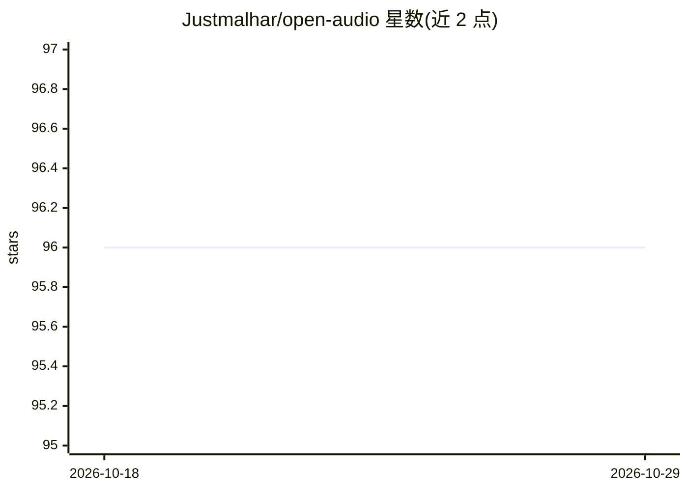

# Justmalhar/open-audio

⭐ 96 · JavaScript · 推送 2025-12-14 · [GitHub](https://github.com/Justmalhar/open-audio) · [官网](https://tts-studio.vercel.app/) · 个人维护

**基于 OpenAI TTS 的网页文字转语音应用，可下载 MP3**

Next.js + Chakra UI 构建的网页应用：用户输入自己的 OpenAI API key（BYO 模式，服务端不存储数据），将文本转为语音，可选择音色、调节语速，并在浏览器中播放或下载 MP3 文件。API key 也可通过环境变量配置（该方式标注为 Disabled，当前保持纯客户端模式）。支持 Vercel 一键部署，或本地 npm 安装运行。注意：项目已宣布 sunset，作者转向后继项目 TTS Studio。

## 筛选速览

| 维度 | 判定 | 备注 |
|---|---|---|
| AI 角色 | `ai-native` | 本体是模型或模型工具 |
| 许可风险 | `none` | — |
| 部署形态 | `library` | 以包/库形式分发 |
| 模型依赖 | — | README 未给出锁定关系 |
| 硬件要求 | — | 无带数字的原话,不猜 |
| 安装摩擦 | `low` | 无编译、无系统依赖或容器化 |
| 成熟度 | — | 结构信号不足 |

## 能力要点

- 调用 OpenAI TTS 模型生成语音，可下载 MP3
- BYO API key 模式，服务端不存储数据
- 音色选择与语速调节
- 支持 Vercel 部署与本地 npm 运行

## 适用场景

- 把文本快速转成语音并下载 MP3
- 自部署一个轻量 TTS 前端供个人使用

## 场景标签

`语音合成` · 领域:内容生成

## 证据(README 行号)

> L11: Open-Audio TTS is a web application that allows users to convert text into natural-sounding speech. Powered by Open
> L15: - **Text-to-Speech**: Convert any text into speech with high-quality voices powered by OpenAI's TTS models.

## 星数曲线

2026-10-18 96 → 2026-10-29 96（+0）

---
*卡片 v1 · prompt 1.4 · 生成 2026-10-23 · 置信度 high · 依据 README sha `3b33c9571967` · [字段定义](../../DATASET.md)*
