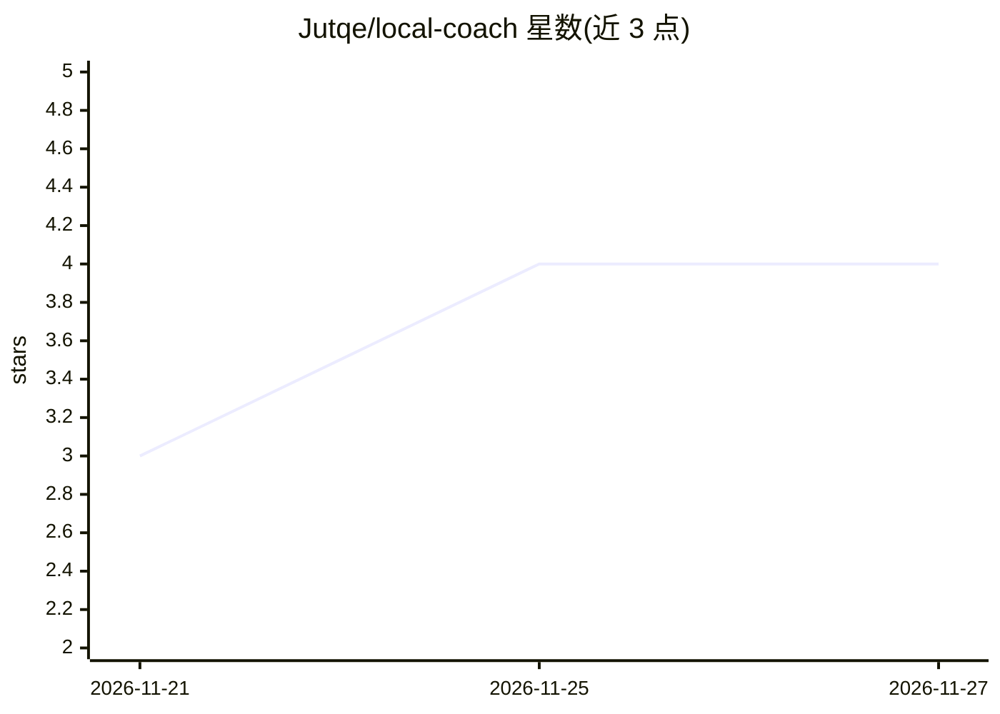

# Jutqe/local-coach

⭐ 4 · Python · MIT · 推送 2026-11-18 · [GitHub](https://github.com/Jutqe/local-coach) · 个人维护 · 中文 README

**本地运行的私人教练-心理陪伴应用，从 Obsidian 笔记学习**

完全在本地机器上通过 Ollama 运行的个人教练应用，读取 Obsidian 或任意 Markdown 笔记库构建个人档案。关键机制：事实抽取附逐字引用并由代码校验、区分 current/past/event/unverified 状态、混合检索（向量+全文+RRF）。功能含聊天、body double 专注陪伴、Life Reset 整理流程、按年展示时间线、Web 界面与背景音混音。仅依赖 Python 标准库，无遥测、无云调用；声明是反思工具而非治疗。

## 筛选速览

| 维度 | 判定 | 备注 |
|---|---|---|
| AI 角色 | `ai-native` | 本体是模型或模型工具 |
| 许可风险 | `permissive` | MIT |
| 部署形态 | `None` |  |
| 模型依赖 | local-ok | 支持本地模型 |
| 硬件要求 | — | 无带数字的原话,不猜 |
| 安装摩擦 | `low` | 无编译、无系统依赖或容器化 |
| 成熟度 | — | 结构信号不足 |

## 能力要点

- 事实抽取附逐字引用，代码逐条校验引用是否存在于笔记
- 混合检索（向量+全文搜索，RRF 合并）与会话摘要、约定跟进
- body double 专注模式与 Life Reset 流程（inventory/triage/audit/hypotheses）
- 仅 Python 标准库依赖，请求只发往本地 Ollama 地址，拒绝云端模型

## 适用场景

- 基于自己的笔记做自我反思与生活梳理
- 需要专注陪伴（body double）时维持工作节奏
- 按年份核对个人经历时间线
- 在离线/局域网环境下进行私人对话

## 场景标签

`知识库管理` `AI 助手` · 领域:对话与助手

## 证据(README 行号)

> L3: **A personal coach-psychologist-mentor with a body double mode that learns from your Obsidian notes (or any Markdown
> L9: - **It reads your vault and remembers you.** Notes are split by headings. A local model extracts facts with a verbat
> L15: - **It talks with you.** The chat uses hybrid retrieval: vectors plus full-text search, merged with RRF. It also ke

## 星数曲线

2026-11-21 3 → 2026-11-27 4（+1）

---
*卡片 v1 · prompt 1.4 · 生成 2026-11-22 · 置信度 high · 依据 README sha `dfcf86d9001b` · [字段定义](../../DATASET.md)*
