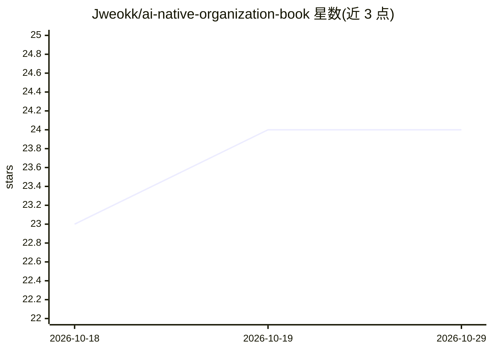

# Jweokk/ai-native-organization-book

⭐ 24 · Python · 推送 2026-10-25 · [GitHub](https://github.com/Jweokk/ai-native-organization-book) · 个人维护 · 中文 README

**免费开源书籍：AI 原生组织的定义、证据与落地方法**

个人作者撰写的免费开源书籍，在线阅读或下载 PDF，中英文版本同步更新。内容围绕“AI 原生组织”：区分“创可贴式 AI 转型”与 AI 原生组织 DNA，引用 HBS/INSEAD/WEF/腾讯研究院的实证研究，并覆盖组织形态重构、工作流再设计与激励机制重建及从零行动手册，数据与案例来源列于附录 A。书籍由自动化流水线生产：每日信息收集入库、每周自动合并、版本化发布。非商业使用免费，商用需书面许可。

## 筛选速览

| 维度 | 判定 | 备注 |
|---|---|---|
| AI 角色 | `ai-knowledge` | 知识聚合/清单类 |
| 许可风险 | `none` | — |
| 部署形态 | `None` |  |
| 模型依赖 | — | README 未给出锁定关系 |
| 硬件要求 | — | 无带数字的原话,不猜 |
| 安装摩擦 | `low` | 无编译、无系统依赖或容器化 |
| 成熟度 | — | 结构信号不足 |

## 能力要点

- 在线免费阅读并提供 PDF 下载，持续版本化更新
- 回答 What/Evidence/How 三问，附实证研究与行动手册
- 由自动化流水线生产：每日采集、每周合并、版本化发布

## 适用场景

- 管理者了解 AI 原生组织与传统 AI 转型的差异
- 寻找组织重构、工作流再设计与激励机制的方法与行动手册
- 查阅企业 AI 落地的实证研究来源

## 场景标签

`教程课程` · 领域:学习与行业

## 证据(README 行号)

> L9: **Read online**: GitHub repository (browse the `book-en/` folder, or read each chapter via the links below) · **Down
> L17: This book is a complete study of "AI-native organizations" — a systemic shift that is happening but doesn't yet hav

## 星数曲线

2026-10-18 23 → 2026-10-29 24（+1）

---
*卡片 v1 · prompt 1.4 · 生成 2026-10-27 · 置信度 high · 依据 README sha `d538889fd94f` · [字段定义](../../DATASET.md)*
