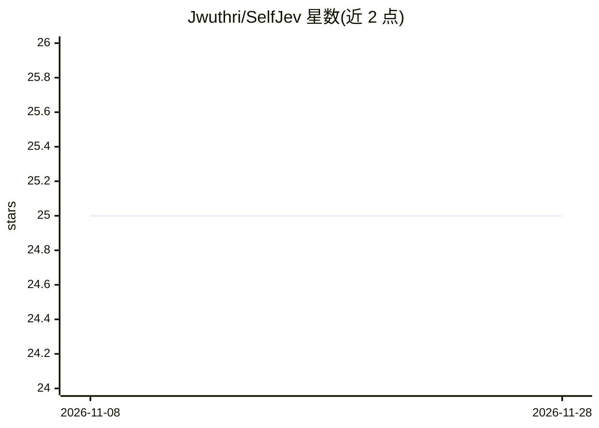

# Jwuthri/SelfJev

⭐ 25 · Python · Apache-2.0 · 推送 2026-10-06 · [GitHub](https://github.com/Jwuthri/SelfJev) · [官网](https://www.selfjev.dev) · 个人维护

**自托管结构化决策模型：文本+问题输出类型化答案与概率**

SelfJev 将文本与问题转化为程序可用的类型化决策：Noul（是/否概率）、Choice（单选）、Score（有序量表分值）、Multi（多选）四种答案类型，直接对候选打分而非生成文本。模型为 Qwen3.5-4B 加 rank-64 LoRA 适配器（230MB），共享前缀树复用文档计算，默认 TreeServer 引擎，另有 vLLM 后端。自托管模式：用户在自有 NVIDIA GPU 上运行模型服务器（建议 24GB 显存；8GB 卡可用 4bit 量化版），应用经 Python SDK 或 Jev 兼容 HTTP API 访问，支持自定义适配器微调（finetune/rlcd）。

## 筛选速览

| 维度 | 判定 | 备注 |
|---|---|---|
| AI 角色 | `ai-native` | 本体是模型或模型工具 |
| 许可风险 | `permissive` | Apache-2.0 |
| 部署形态 | `library` | 以包/库形式分发 |
| 模型依赖 | local-ok | 支持本地模型 |
| 硬件要求 | — | 无带数字的原话,不猜 |
| 安装摩擦 | `medium` | 含编译或系统依赖之一 |
| 成熟度 | — | 结构信号不足 |

## 能力要点

- 四种类型化答案（Noul/Choice/Score/Multi）直接输出概率，不做文本生成
- 共享前缀树：一次读取文档，多问题复用计算
- Jev 兼容 API 与 OpenRouter decisions 端点兼容
- 8GB 显卡可运行 4bit 量化版（3.3GB 检查点）

## 适用场景

- 对客户消息做意图识别、分派团队并打标签
- 审核 AI 回答的事实支持与策略违规
- 基于自有标注数据微调决策模型适配业务规则

## 场景标签

`微调` `推理引擎` · 领域:训练与推理

## 证据(README 行号)

> L11: **SelfJev turns text and questions into decisions your code can use.** Route a request, check an AI response, or ap
> L25: |Does this need a refund?|`Noul`|Probability of yes|
> L98: SelfJev-4B combines **Qwen3.5-4B** with a trained **rank-64 LoRA adapter**. Its shared-prefix tree reuses the docum

## 星数曲线

2026-11-08 25 → 2026-11-28 25（+0）

---
*卡片 v1 · prompt 1.4 · 生成 2026-11-18 · 置信度 high · 依据 README sha `9ff0a0d1d5ef` · [字段定义](../../DATASET.md)*
