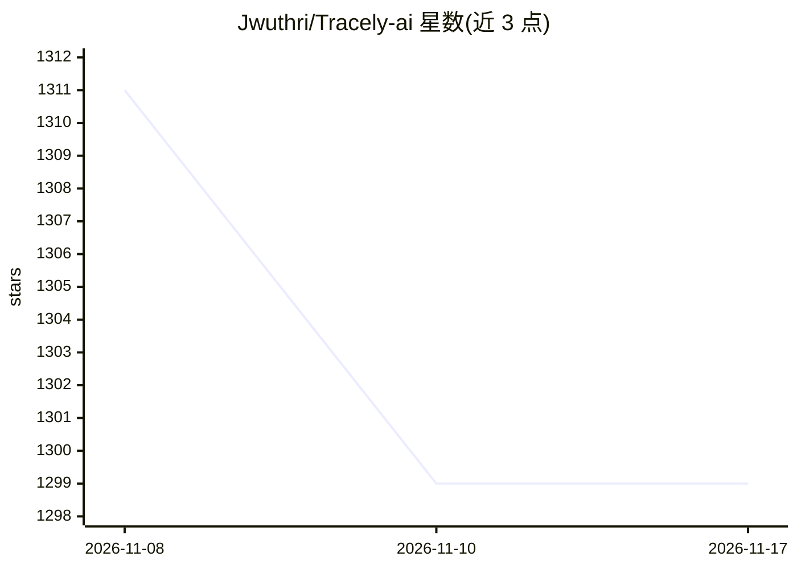

# Jwuthri/Tracely-ai

⭐ 1,299 · Python · MIT · 推送 2026-11-16 · [GitHub](https://github.com/Jwuthri/Tracely-ai) · [官网](https://tracely-ai.com) · 个人维护

**面向 AI agent 的 trace 原生 CI/CD：生产失败转为回归测试并拦截 PR**

Tracely 通过 OTLP 摄取 agent 运行 trace，用在线评估器（LLM-as-judge 与无模型结构检查）给每条 run 打分，将失败聚类为 issue，并可一键把失败 trace 冻结为封闭回放用例（录制输入与 LLM/工具输出作为 fixture，附带 fail-to-pass 契约）。CI 中通过 tracely gate 离线回放、阻断 PR，并支持 Slack/email/webhook 告警流、趋势分析与 judge 校准。面向构建 agent 产品的开发者，提供 pip SDK 与 Docker 一键自托管全栈（Postgres/ClickHouse/Redis/MinIO）。

## 筛选速览

| 维度 | 判定 | 备注 |
|---|---|---|
| AI 角色 | `ai-ecosystem` | LLM/agent 周边工具 |
| 许可风险 | `permissive` | MIT |
| 部署形态 | `self-host` | docker 或自建部署 |
| 模型依赖 | locked-api |  |
| 硬件要求 | — | 无带数字的原话,不猜 |
| 安装摩擦 | `low` | 无编译、无系统依赖或容器化 |
| 成熟度 | — | 结构信号不足 |

## 能力要点

- 失败 trace 冻结为封闭回放用例，CI 回放无需 API key 与模型开销
- LLM-as-judge 在 conversation/run/span 层级在线评分
- 失败按结构与语义聚类为 issue，附建议评估器
- tracely gate 提交 commit status、PR 评论并阻断合入

## 适用场景

- 把生产环境真实失败固化成回归用例，防止同类问题再次上线
- 在 CI 中离线回放 agent 行为并对 PR 设质量门禁
- 对失败进行聚类分级并通过 Slack/webhook 收到告警
- 校准 LLM judge 与人工标注的一致性，避免误报拦截发布

## 场景标签

`LLM 可观测性` `模型评测` · 领域:评测与运维

## 证据(README 行号)

> L7: **Trace-native CI/CD for AI agents.** Tracely grades every agent trace as it lands, clusters the
> L97: The suite replays in CI against recorded fixtures: deterministic, offline, **no API keys and no model
> L79: Online evaluators grade every run as it lands (LLM-as-judge at conversation / run / span level, plus

## 星数曲线

2026-11-08 1,311 → 2026-11-17 1,299（-12）

---
*卡片 v1 · prompt 1.4 · 生成 2026-11-17 · 置信度 mid · 依据 README sha `e28e8fc38859` · [字段定义](../../DATASET.md)*
