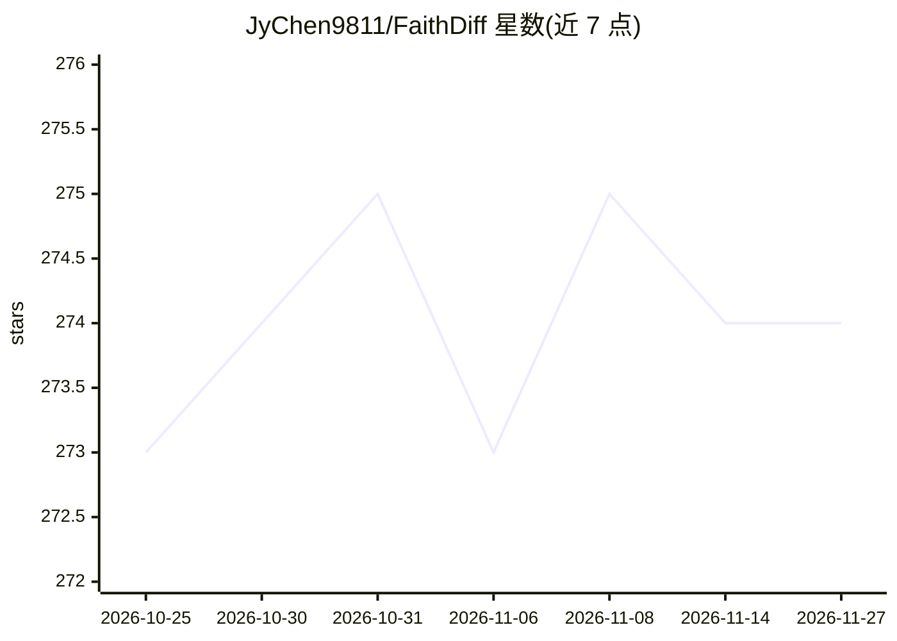

# JyChen9811/FaithDiff

⭐ 274 · Python · MIT · 推送 2026-10-31 · [GitHub](https://github.com/JyChen9811/FaithDiff) · 组织维护 · 中文 README

**面向老照片/胶片等真实退化的扩散模型图像超分与修复库**

CVPR 2025 论文 FaithDiff 的官方实现，利用扩散先验做忠实图像超分辨率，适用于经典胶片翻新、老照片修复、社交媒体图像恢复、图像增强与 AIGC 结果增强。提供 Gradio demo、训练与测试脚本、预训练模型及 238 张未知退化图像的 RealDeg 测试集；支持 FP8 推理、CPU offloading、8K 及以上超高分辨率修复，代码已集成进 Diffusers。

## 筛选速览

| 维度 | 判定 | 备注 |
|---|---|---|
| AI 角色 | `ai-native` | 本体是模型或模型工具 |
| 许可风险 | `permissive` | MIT |
| 部署形态 | `None` |  |
| 模型依赖 | — | README 未给出锁定关系 |
| 硬件要求 | `gpu-8g` | |
| 安装摩擦 | `low` | 无编译、无系统依赖或容器化 |
| 成熟度 | — | 结构信号不足 |

## 能力要点

- 支持 FP8 推理与 CPU offloading，2x 放大仅需约 5GB 显存
- 24GB GPU 上支持 8K 及以上超高分辨率修复
- 提供训练代码、测试代码与预训练模型
- 代码已集成进 Diffusers 库

## 适用场景

- 翻新经典胶片与老照片
- 修复社交媒体上的低质图像
- 对 AIGC 生成的图像做增强
- 在低显存 GPU 上运行图像超分

## 场景标签

`图像视频处理` · 领域:感知与多模态

## 证据(README 行号)

> L1: ### (CVPR 2025) FaithDiff: Unleashing Diffusion Priors for Faithful Image Super-resolution
> L23: - ✅ March 28, 2025. Update a nice gradio demo.
> L39: ### :gift: Gradio Demo

## 星数曲线

2026-10-25 273 → 2026-11-27 274（+1）

---
*卡片 v1 · prompt 1.4 · 生成 2026-11-25 · 置信度 high · 依据 README sha `229fbe72bc89` · [字段定义](../../DATASET.md)*
