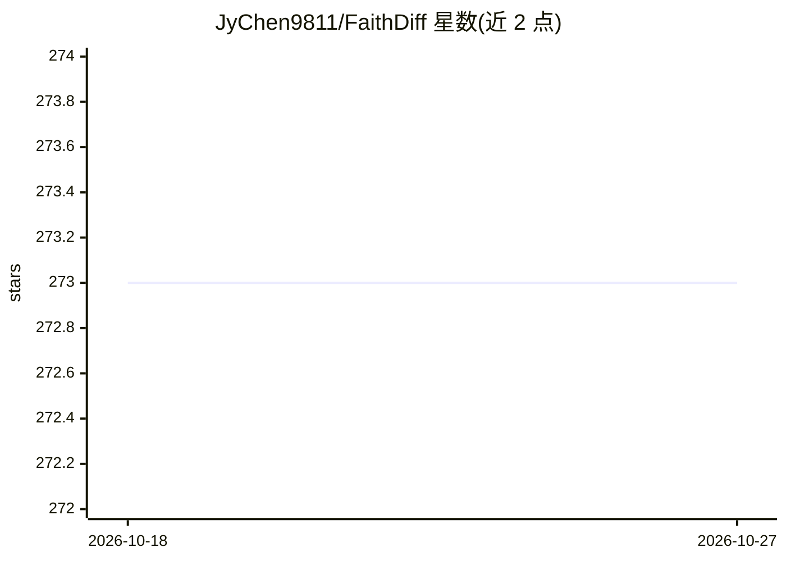

# JyChen9811/FaithDiff

⭐ 273 · Python · MIT · 推送 2026-03-25 · [GitHub](https://github.com/JyChen9811/FaithDiff) · 组织维护 · 中文 README

**扩散先验图像超分复原模型，用于老照片/老电影修复**

CVPR 2025 论文 FaithDiff 的官方实现，基于扩散先验做真实世界图像超分辨率与复原，覆盖老照片修复、经典电影修复、社交媒体图像修复与 AIGC 图像增强。结合 LLaVA 生成退化感知提示（可关闭），支持 8K 及以上超高分复原；提供 Gradio 演示、训练与测试代码及预训练模型，代码已集成进 Diffusers。FP8 推理加 CPU offload 时 2 倍上采样仅需约 5GB 显存。由南京理工大学 IMAG Lab 团队维护。

## 筛选速览

| 维度 | 判定 | 备注 |
|---|---|---|
| AI 角色 | `ai-native` | 本体是模型或模型工具 |
| 许可风险 | `permissive` | MIT |
| 部署形态 | `None` |  |
| 模型依赖 | — | README 未给出锁定关系 |
| 硬件要求 | `gpu-8g` | |
| 安装摩擦 | `low` | 无编译、无系统依赖或容器化 |
| 成熟度 | — | 结构信号不足 |

## 能力要点

- 基于扩散先验的图像超分/复原，含 LLaVA 提示生成（可关闭）
- 支持 8K 及以上超高分复原；FP8+CPU offload 下 2x 上采样约 5GB 显存
- 提供训练（两阶段）与测试脚本、预训练模型及 Gradio 演示
- 代码已集成进 Diffusers，并发布含 238 张图的 RealDeg 测试集

## 适用场景

- 修复老照片与经典电影胶片影像
- 恢复社交媒体压缩图像质量
- 对 AIGC 生成图像做增强处理

## 场景标签

`图像视频处理` · 领域:感知与多模态

## 证据(README 行号)

> L1: ### (CVPR 2025) FaithDiff: Unleashing Diffusion Priors for Faithful Image Super-resolution
> L25: - ✅ February 09, 2025. Support ultra-high-resolution (8K and above) image restoration on 24GB GPUs.
> L47: --use_fp8 = Changes the diffusion model precision from FP16 to FP8, significantly reducing GPU memory requirements.

## 星数曲线

2026-10-18 273 → 2026-10-27 273（+0）

---
*卡片 v1 · prompt 1.4 · 生成 2026-10-22 · 置信度 high · 依据 README sha `90466095b853` · [字段定义](../../DATASET.md)*
