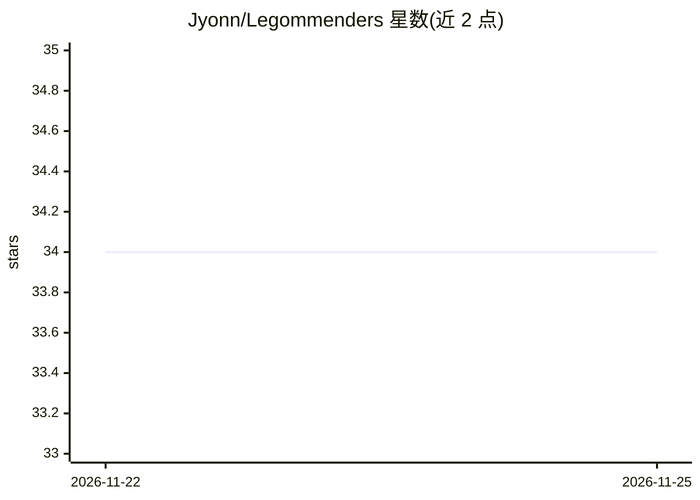

# Jyonn/Legommenders

⭐ 34 · Python · MIT · 推送 2026-11-21 · [GitHub](https://github.com/Jyonn/Legommenders) · [官网](https://lego.qijiong.work) · 个人维护

**面向研究者的内容推荐库：组合模块实现 15+ 推荐模型并接入 LLM**

TheWebConf'25 论文 Legommenders 的官方配套库，采用模块化分层架构：数据集处理器将原始数据转为统一三表，内容算子（GloVe/CNN/BERT/Llama 等 15+ 模块）编码物品内容，行为算子（注意力/RNN/Transformer 等 8+）编码用户历史，点击预测器（Dot/MLP/DeepFM/DCN 等）输出预测。支持 15+ 数据集（Native/Bridge/Community 三类接入通道），通过 YAML 配置训练与评估，提供 GAUC/MRR/NDCG 等多种指标。安装需 Python 3.11+、PyTorch 2.6+ 与 Transformers 4.57.6/5.x。

## 筛选速览

| 维度 | 判定 | 备注 |
|---|---|---|
| AI 角色 | `ai-ecosystem` | LLM/agent 周边工具 |
| 许可风险 | `permissive` | MIT |
| 部署形态 | `library` | 以包/库形式分发 |
| 模型依赖 | — | README 未给出锁定关系 |
| 硬件要求 | — | 无带数字的原话,不猜 |
| 安装摩擦 | `medium` | 含编译或系统依赖之一 |
| 成熟度 | — | 结构信号不足 |

## 能力要点

- 实现 15+ 模型：NAML、NRMS、LSTUR、ONCE、IISAN、DeepFM、DCN 等，均带 YAML 配置
- 支持 15+ 数据集，分 Native/Bridge/Community 三类接入通道
- LLM 适配：可定义 HuggingFace 语言模型，支持 ONCE、IISAN 等 LLM 模型
- 可选 BF16 混合精度训练与梯度累积、epoch 批次控制选项

## 适用场景

- 在 MIND 等新闻数据集上复现或对比内容推荐模型
- 为论文实验统一预处理、训练与评估多个推荐基线
- 接入 HuggingFace 语言模型做基于内容的推荐研究

## 场景标签

`推荐系统` `科研工具` · 领域:学习与行业

## 证据(README 行号)

> L4: > Legommenders is a content-based recommendation library designed for the era of large language models.
> L109: Legommenders is built with **a modular, layered architecture**:
> L112: - **Content Operator**: Encodes item content using static (e.g., Glove) or deep models (e.g., CNN, BERT, GPT). Sup

## 星数曲线

2026-11-22 34 → 2026-11-25 34（+0）

---
*卡片 v1 · prompt 1.4 · 生成 2026-11-22 · 置信度 mid · 依据 README sha `fdb593c826b4` · [字段定义](../../DATASET.md)*
