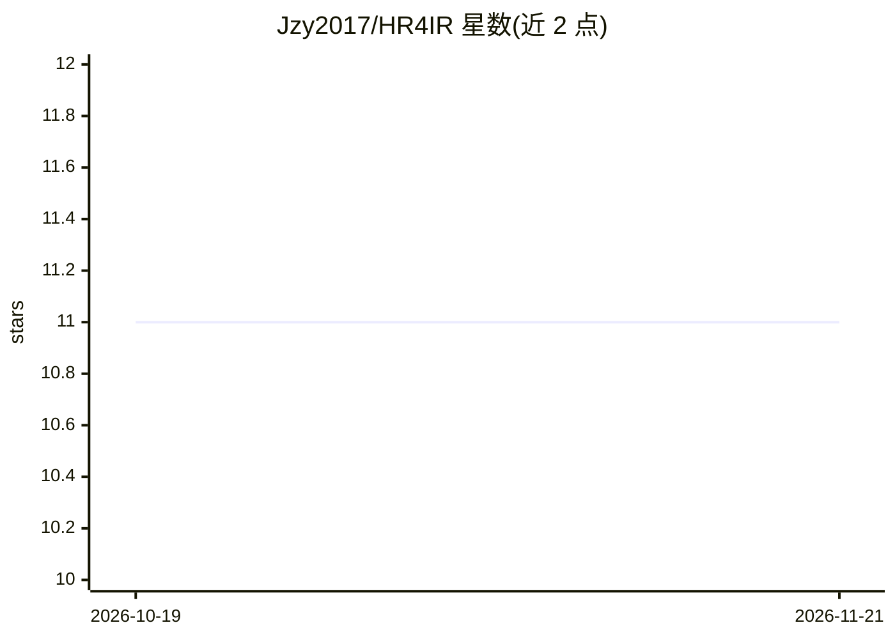

# Jzy2017/HR4IR

⭐ 11 · Python · MIT · 推送 2026-03-25 · [GitHub](https://github.com/Jzy2017/HR4IR) · 个人维护

**红外与可见光图像对齐论文 HR4IR 的官方实现**

TIP 2025 论文《Harmonized Domain Enabled Alternate Search for Infrared and Visible Image Alignment》的代码实现，任务为红外与可见光图像对齐。仓库提供预训练模型与数据集的下载链接（Google Drive，分别放入 checkpoints/ 与 benchmarks/ 目录），并给出 python test.py 的快速测试入口；README 未说明训练流程与具体指标，内容以论文复现为主。

## 筛选速览

| 维度 | 判定 | 备注 |
|---|---|---|
| AI 角色 | `ai-native` | 本体是模型或模型工具 |
| 许可风险 | `permissive` | MIT |
| 部署形态 | `None` |  |
| 模型依赖 | — | README 未给出锁定关系 |
| 硬件要求 | — | 无带数字的原话,不猜 |
| 安装摩擦 | `low` | 无编译、无系统依赖或容器化 |
| 成熟度 | — | 结构信号不足 |

## 能力要点

- 论文 HR4IR（TIP 2025）的代码实现
- 提供预训练模型与数据集的 Google Drive 下载
- 提供 python test.py 快速测试入口

## 适用场景

- 复现 HR4IR 论文的红外-可见光图像对齐结果
- 使用发布权重在自己的数据上运行对齐测试

## 场景标签

`图像视频处理` `科研工具` · 领域:学习与行业

## 证据(README 行号)

> L3: **“Harmonized Domain Enabled Alternate Search for Infrared and Visible Image Alignment"**,
> L10: Download the pre-trained model and dataset, and put them in checkpoints/ and benchmarks/
> L16: python test.py

## 星数曲线

2026-10-19 11 → 2026-11-21 11（+0）

---
*卡片 v1 · prompt 1.4 · 生成 2026-11-19 · 置信度 mid · 依据 README sha `6c4ed9bbc46d` · [字段定义](../../DATASET.md)*
