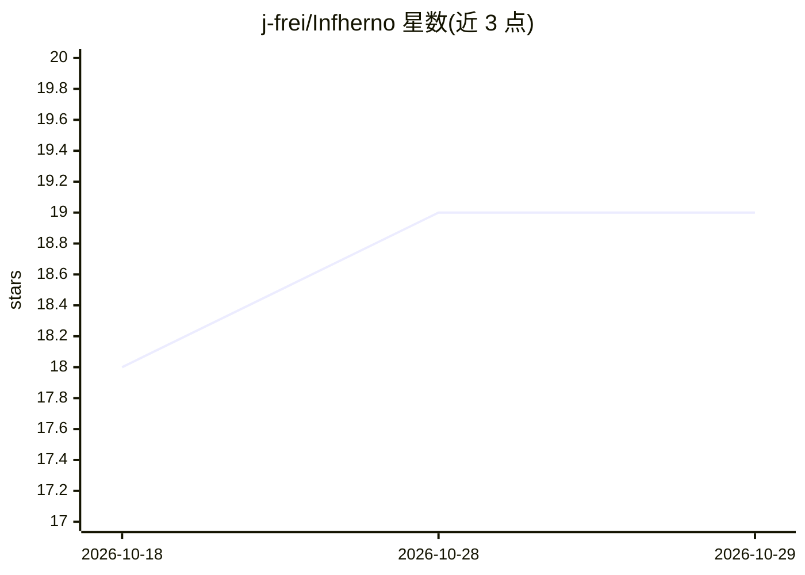

# j-frei/Infherno

⭐ 19 · Python · 推送 2026-04-02 · [GitHub](https://github.com/j-frei/Infherno) · 组织维护

**将非结构化临床笔记转换为 FHIR 格式的端到端 Agent**

基于 Hugging Face SmolAgents 构建的端到端 agent：解析自由文本医疗文档，将其映射为标准化 FHIR 资源，支持多步推理与工具调用。通过 RAG 提供 SNOMED CT 与 HL7 ValueSets 本体支持，将抽取的医学概念对齐到标准术语。实验使用 Gemini Pro 2.5 等商用模型；README 指出本地模型可靠性较低，建议通过 API 调用专有模型本地运行。需自建 Snowstorm 实例。提供公开在线 Demo 与 EACL 2026 论文。

## 筛选速览

| 维度 | 判定 | 备注 |
|---|---|---|
| AI 角色 | `ai-native` | 本体是模型或模型工具 |
| 许可风险 | `none` | — |
| 部署形态 | `library` | 以包/库形式分发 |
| 模型依赖 | — | README 未给出锁定关系 |
| 硬件要求 | — | 无带数字的原话,不猜 |
| 安装摩擦 | `low` | 无编译、无系统依赖或容器化 |
| 成熟度 | — | 结构信号不足 |

## 能力要点

- 临床自由文本到 FHIR 资源的自动解析与映射
- 基于 SmolAgents 的多步推理与工具使用 agent
- SNOMED CT 与 HL7 ValueSets 的 RAG 术语接地
- 提供公开在线 Demo（内部 Snowstorm 实例）

## 适用场景

- 把病历自由文本转换为标准化 FHIR 数据实现系统互通
- 将抽取的医学概念编码对齐到 SNOMED CT 标准术语
- 医疗信息系统间的临床数据互操作

## 场景标签

`文档解析` · 领域:知识与检索

## 证据(README 行号)

> L3: Infherno is an end-to-end agent that transforms unstructured clinical notes into structured FHIR (Fast Healthcare In
> L7: Built on Hugging Face’s SmolAgents library, Infherno supports multi-step reasoning, tool use, and modular extensibil
> L9: Infherno also provides ontology support for SNOMED CT and HL7 ValueSets using Retrieval-Augmented Generation (RAG). 

## 星数曲线

2026-10-18 18 → 2026-10-29 19（+1）

---
*卡片 v1 · prompt 1.4 · 生成 2026-10-28 · 置信度 mid · 依据 README sha `3938593b95b9` · [字段定义](../../DATASET.md)*
