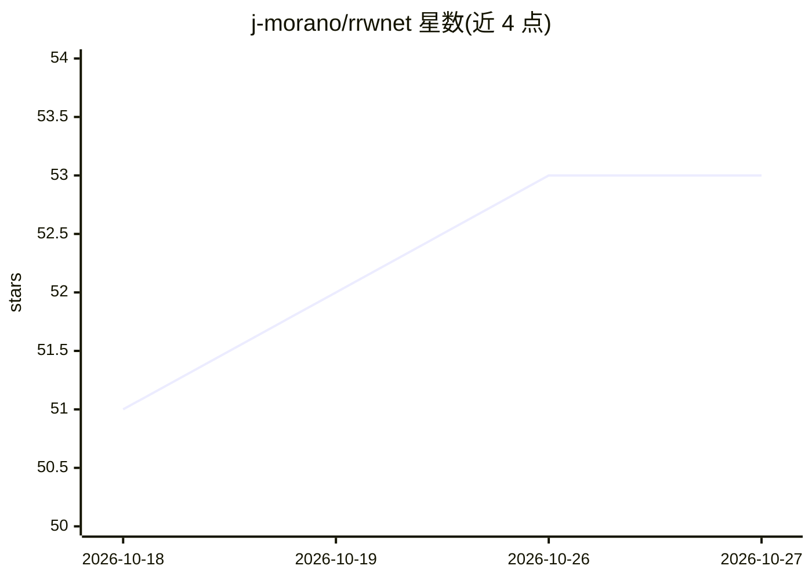

# j-morano/rrwnet

⭐ 53 · Python · MIT · 推送 2026-08-05 · [GitHub](https://github.com/j-morano/rrwnet) · [官网](https://doi.org/10.1016/j.eswa.2024.124970) · 个人维护

**视网膜动静脉分割与分类的深度学习模型（论文官方实现）**

RRWNet 论文（Expert Systems with Applications, 2024）的官方 PyTorch 实现：对彩色眼底图像做视网膜动脉/静脉的分割与分类，采用递归细化框架修正分割图中的明显错误，并提供可独立使用的细化后处理模块来精化其他模型的预测。提供预训练权重（RITE/HRF 数据集）、预测脚本、训练与评估代码，权重与预测结果托管于 GitHub release 与 Hugging Face。需 Python <3.13，按 requirements.txt 安装依赖，推理前需运行 preprocessing.py 预处理。该方法是 GAVE Challenge (MICCAI 2025) 的获胜方法。

## 筛选速览

| 维度 | 判定 | 备注 |
|---|---|---|
| AI 角色 | `ai-native` | 本体是模型或模型工具 |
| 许可风险 | `permissive` | MIT |
| 部署形态 | `desktop` | 安装包/桌面程序 |
| 模型依赖 | — | README 未给出锁定关系 |
| 硬件要求 | — | 无带数字的原话,不猜 |
| 安装摩擦 | `low` | 无编译、无系统依赖或容器化 |
| 成熟度 | — | 结构信号不足 |

## 能力要点

- 递归细化框架结合模块堆叠，修正分割图中的明显错误
- 可独立使用的细化模块，可后处理其他模型（如 U-Net）的预测
- 提供 RITE/HRF 数据集预训练权重与预处理、推理、训练、评估全流程脚本
- GAVE Challenge (MICCAI 2025) 获胜方法（R2-V2 权重另存于 Hugging Face）

## 适用场景

- 对眼底彩照做视网膜动脉/静脉分割与分类
- 精化已有血管分割模型的输出结果
- 复现论文结果或在 RITE/LES-AV/HRF 上训练评估模型

## 场景标签

`目标检测` · 领域:感知与多模态

## 证据(README 行号)

> L15: This is the official repository of the paper "RRWNet: Recursive Refinement Network for Effective Retinal Artery/Vei
> L29: * Human-level, state-of-the-art performance on retinal artery/vein segmentation and classification.
> L45: The models can be easily used with the `model.py` code and loading the weights with Hugging Face 🤗. The only requir

## 星数曲线

2026-10-18 51 → 2026-10-27 53（+2）

---
*卡片 v1 · prompt 1.4 · 生成 2026-10-24 · 置信度 high · 依据 README sha `0c452fe8a35a` · [字段定义](../../DATASET.md)*
