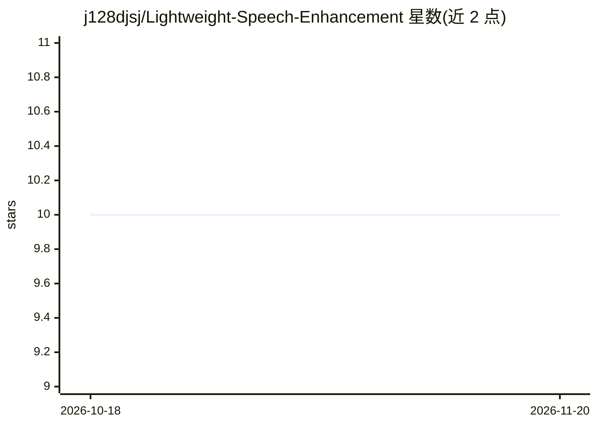

# j128djsj/Lightweight-Speech-Enhancement

⭐ 10 · Python · MIT · 推送 2026-08-05 · [GitHub](https://github.com/j128djsj/Lightweight-Speech-Enhancement) · [官网](https://doi.org/10.1016/j.dsp.2026.105987) · 个人维护

**研究者的轻量语音增强模型 PyTorch 实现**

论文配套的官方 PyTorch 实现：用状态空间 FeatureMask（LightS4）结合深度可分离卷积、心理声学频谱压缩、多尺度上下文建模与 Griffin–Lim 相位精化做语音增强。训练通过 JSON 配对干净语音与噪声、脚本启动，默认超参复现论文配置（16 kHz、150 epochs）；提供模型/FLOPs/判别器 profiling 脚本。面向语音处理研究者，附论文引用与图表素材；许可证为 MIT，论文图片单独说明且不受代码许可覆盖。

## 筛选速览

| 维度 | 判定 | 备注 |
|---|---|---|
| AI 角色 | `ai-native` | 本体是模型或模型工具 |
| 许可风险 | `permissive` | MIT |
| 部署形态 | `library` | 以包/库形式分发 |
| 模型依赖 | — | README 未给出锁定关系 |
| 硬件要求 | — | 无带数字的原话,不猜 |
| 安装摩擦 | `low` | 无编译、无系统依赖或容器化 |
| 成熟度 | — | 结构信号不足 |

## 能力要点

- LightS4 状态空间模块与 DSConv+ASPP 编码器的组合架构
- 双路径时频 FeatureMask，交叉门控生成增强掩码
- 提供训练与 profiling 脚本，默认配置复现论文设定
- 支持仅训练时使用的辅助说话人分类

## 适用场景

- 复现论文中的语音增强实验结果
- 在自己配对的干净/噪声语料上训练增强模型
- 分析轻量模型参数量与计算量分布

## 场景标签

 · 领域:语音处理/深度学习研究

## 证据(README 行号)

> L7:  Official PyTorch implementation of
> L8:  Lightweight speech enhancement with state-space model and depthwise separable convolution
> L15: The model combines a lightweight state-space FeatureMask with depthwise separable convolution, psychoacoustic spect

## 星数曲线

2026-10-18 10 → 2026-11-20 10（+0）

---
*卡片 v1 · prompt 1.4 · 生成 2026-11-19 · 置信度 high · 依据 README sha `749e278c0801` · [字段定义](../../DATASET.md)*
