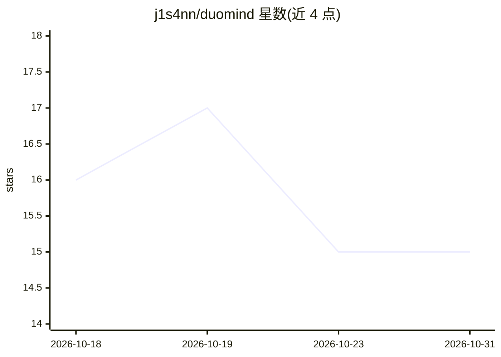

# j1s4nn/duomind

⭐ 15 · Python · MIT · 推送 2026-09-29 · [GitHub](https://github.com/j1s4nn/duomind) · [官网](https://j1s4nn.github.io/duomind) · 个人维护

**双系统本地 LLM 服务器：Jev 分类 API 引导小模型推理**

DuoMind 是一个 OpenAI 兼容的本地 LLM 服务器：System 2 为经 llama.cpp 运行的小型本地模型（Phi-4/Qwen/Gemma/Llama），负责生成；System 1 为 TypeSafe AI 的 Jev 付费分类 API，负责决策与技能选择，向每个请求注入任务工作流与 tool calling 引导。生成全程本地，但需要联网调用 Jev API。提供 duomind CLI（setup/start/stop/status/logs/models），支持 Windows/Linux/macOS，面向 Cline、Kilo Code 等编码助手接入。README 附 100 次请求的基准数据：开启 Jev 后整体延迟 +36%，输出 token +60%。

## 筛选速览

| 维度 | 判定 | 备注 |
|---|---|---|
| AI 角色 | `ai-ecosystem` | LLM/agent 周边工具 |
| 许可风险 | `permissive` | MIT |
| 部署形态 | `desktop` | 安装包/桌面程序 |
| 模型依赖 | local-ok | 支持本地模型 |
| 硬件要求 | — | 无带数字的原话,不猜 |
| 安装摩擦 | `medium` | 含编译或系统依赖之一 |
| 成熟度 | — | 结构信号不足 |

## 能力要点

- OpenAI 兼容本地服务器，支持 tool calling 与技能注入（webdev/coding/debug/git 等 6 类）
- Jev 分类 API（System 1）与本地小模型（System 2）分工，生成 100% 本地
- duomind CLI 覆盖 setup 向导、启动/停止、日志与模型切换
- 可从 Hugging Face 下载任意 GGUF 模型（断点续传）

## 适用场景

- 给 Cline / Kilo Code 接一个本地、OpenAI 兼容的编码模型后端
- 在小显存机器上运行 3B 级模型做编码任务
- 用 Jev 引导小模型执行多步骤任务（网页复刻、调试、git 操作）

## 场景标签

`模型网关` `推理引擎` · 领域:Agent 开发

## 证据(README 行号)

> L5: A dual-system, OpenAI-compatible local LLM server that runs small models (Phi-4, Qwen, Gemma, Llama) privately on yo
> L7: DuoMind combines System 2 (a small local LLM via llama.cpp) with System 1 (a fast classification API) so a 3B model 
> L282: 2. Set **API Provider**: `OpenAI Compatible`

## 星数曲线

2026-10-18 16 → 2026-10-31 15（-1）

---
*卡片 v1 · prompt 1.4 · 生成 2026-10-30 · 置信度 mid · 依据 README sha `06b43bc22c91` · [字段定义](../../DATASET.md)*
