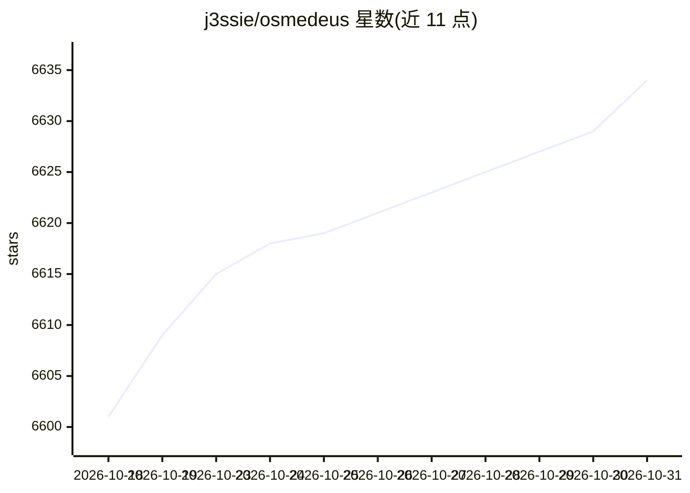

# j3ssie/osmedeus

⭐ 6,634 · Go · MIT · 推送 2026-10-04 · [GitHub](https://github.com/j3ssie/osmedeus) · [官网](https://www.osmedeus.org/) · 个人维护

**安全工作流编排引擎：以 YAML 声明式自动化侦察与扫描**

面向安全测试的声明式编排引擎，将复杂工作流定义为可审计的 YAML，支持条件分支、事件驱动调度、Redis 主从分布式执行与多 runner（host/Docker/SSH）。提供 80+ 工具函数（nmap 集成、SSH 执行、SARIF 解析等）、云端扫描（AWS/GCP/Azure 等）、REST API 与 Web UI。其中 LLM 部分为 Agentic 步骤：工具调用循环、子代理编排，并支持 Claude Code、Codex 等 ACP 子进程代理。以安装脚本、npm 包、Docker 镜像及预编译二进制分发。

## 筛选速览

| 维度 | 判定 | 备注 |
|---|---|---|
| AI 角色 | `ai-enhanced` | 去掉 AI 部分产品仍成立 |
| 许可风险 | `permissive` | MIT |
| 部署形态 | `self-host` | docker 或自建部署 |
| 模型依赖 | — | README 未给出锁定关系 |
| 硬件要求 | — | 无带数字的原话,不猜 |
| 安装摩擦 | `low` | 无编译、无系统依赖或容器化 |
| 成熟度 | — | 结构信号不足 |

## 能力要点

- 声明式 YAML 工作流，支持钩子、条件分支与模块排除
- Agentic LLM 步骤：工具调用循环与子代理编排，支持 ACP 子进程代理（Claude Code/Codex/OpenCode/Gemini）
- Redis 主从分布式执行与事件驱动调度（cron/文件监听/webhook）
- 云端扫描支持 DigitalOcean/AWS/GCP/Linode/Azure，含成本控制与自动清理

## 适用场景

- 对目标资产运行自动化侦察与扫描流水线
- 用 YAML 定义可审计的安全工作流并分布式执行
- 在云上按需发起扫描并自动清理资源

## 场景标签

`网络安全` `工作流自动化` · 领域:效率与自动化

## 证据(README 行号)

> L9: Osmedeus is a security focused declarative orchestration engine that simplifies complex workflow automation into aud
> L19: - **Agentic LLM Steps** - Tool-calling agent loops with sub-agent orchestration, memory management, and structured 

## 星数曲线

2026-10-18 6,601 → 2026-10-31 6,634（+33）

---
*卡片 v1 · prompt 1.4 · 生成 2026-10-20 · 置信度 high · 依据 README sha `a09b74bccce7` · [字段定义](../../DATASET.md)*
