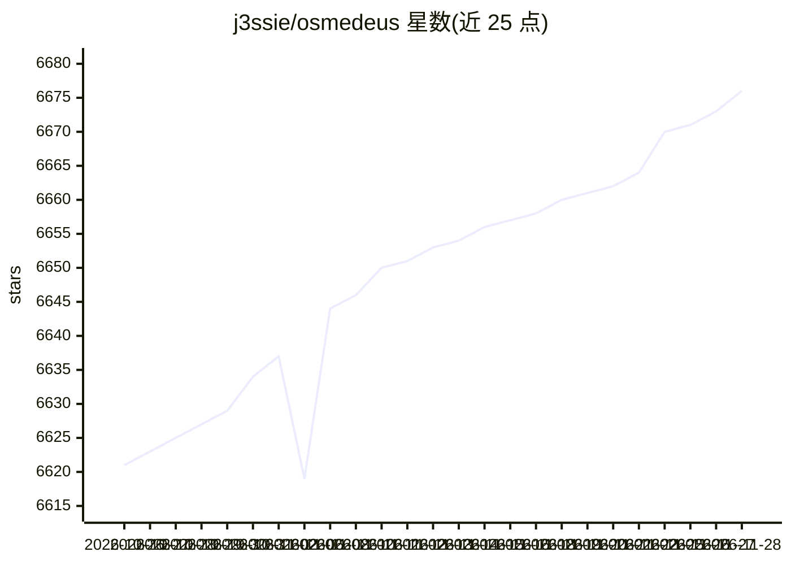

# j3ssie/osmedeus

⭐ 6,676 · Go · MIT · 推送 2026-11-25 · [GitHub](https://github.com/j3ssie/osmedeus) · [官网](https://www.osmedeus.org/) · 个人维护 · 中文 README

**面向安全工作者的声明式工作流编排引擎**

用 YAML 声明安全工作流的编排引擎，同一份配置可在本机、Docker 或 SSH 上运行；支持基于 Redis 的主从分布式执行、Cron/文件监听/事件触发调度、80+ 实用函数库（nmap 集成、SARIF 解析、CDN/WAF 分类等）。提供 REST API 与内嵌 Web UI，可对接 DigitalOcean、AWS、GCP 等云厂商开通机器执行扫描。含工具调用 LLM agent 步骤与 ACP 子代理（Claude Code、Codex 等）。README 警告会执行任意代码，要求审查工作流内容。

## 筛选速览

| 维度 | 判定 | 备注 |
|---|---|---|
| AI 角色 | `ai-enhanced` | 去掉 AI 部分产品仍成立 |
| 许可风险 | `permissive` | MIT |
| 部署形态 | `self-host` | docker 或自建部署 |
| 模型依赖 | locked-api |  |
| 硬件要求 | — | 无带数字的原话,不猜 |
| 安装摩擦 | `low` | 无编译、无系统依赖或容器化 |
| 成熟度 | — | 结构信号不足 |

## 能力要点

- YAML 声明式工作流，支持主机/Docker/SSH 三种运行器
- Redis 主从分布式执行与任务队列、webhook 触发
- 80+ 函数库：nmap、tmux、SSH、SARIF 解析、WAF/CDN 分类
- 工具调用 agent 循环与 ACP 子代理编排

## 适用场景

- 编排自动化侦察与攻击面管理工作流
- 在多台云主机上分发运行安全扫描任务
- 把 SAST 工具（Semgrep、Trivy）结果统一解析与展示

## 场景标签

`工作流自动化` `网络安全` · 领域:效率与自动化

## 证据(README 行号)

> L9: Osmedeus is a security-focused declarative orchestration engine. It defines workflow automation in YAML you can read
> L19: - **Agentic LLM steps.** Tool-calling agent loops with sub-agent orchestration, memory management, and structured o

## 星数曲线

2026-10-26 6,621 → 2026-11-28 6,676（+55）

---
*卡片 v1 · prompt 1.4 · 生成 2026-11-26 · 置信度 high · 依据 README sha `ba8cae469ba7` · [字段定义](../../DATASET.md)*
