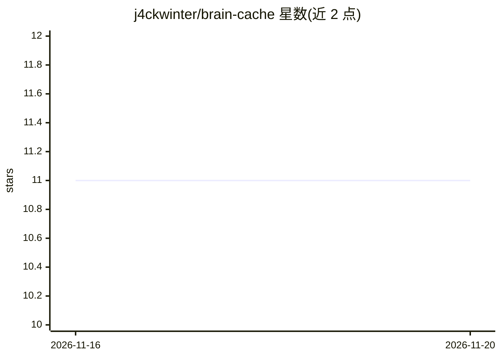

# j4ckwinter/brain-cache

⭐ 11 · TypeScript · NOASSERTION · 推送 2026-11-09 · [GitHub](https://github.com/j4ckwinter/brain-cache) · 个人维护

**为 Claude Code 提供本地 AST 感知代码库索引与检索的上下文引擎**

brain-cache 是运行在本地的代码库上下文引擎，面向 Claude Code 用户：用 AST 感知分块（按函数/类/方法边界）替代按行数切分，结合语义嵌入与精确符号名检索相关代码片段，并按近似 token 预算组装上下文。通过 MCP 服务器接入 Claude Code，提供 build_context、search_codebase、index_repo 等工具；init 命令自动配置 .mcp.json、安装技能文件与 PreToolUse 提示钩子。索引与检索完全本地运行，依赖本地 Ollama；仅 ask 命令调用 Anthropic API。索引支持增量更新、多代快照与发布回滚。

## 筛选速览

| 维度 | 判定 | 备注 |
|---|---|---|
| AI 角色 | `ai-ecosystem` | LLM/agent 周边工具 |
| 许可风险 | `none` | NOASSERTION |
| 部署形态 | `library` | 以包/库形式分发 |
| 模型依赖 | local-ok | 支持本地模型 |
| 硬件要求 | — | 无带数字的原话,不猜 |
| 安装摩擦 | `low` | 无编译、无系统依赖或容器化 |
| 成熟度 | — | 结构信号不足 |

## 能力要点

- AST 感知分块：以函数/类/方法为完整单元，支持 TS/JS、Python、Go、Rust
- 检索融合语义匹配与精确符号名排名，并提供无 Ollama 时的关键词回退
- 通过 MCP 接入 Claude Code，自动生成 .mcp.json 并安装技能与提示钩子
- 本地增量索引、watch 模式与多代快照发布机制

## 适用场景

- 让 Claude Code 读取相关代码片段而非整个文件以减少 token 消耗
- 在大型仓库中按语义查找函数、类型与符号定义
- 本地环境中索引代码库且代码不离开本机
- 通过 watch 模式在文件保存后持续同步索引

## 场景标签

`语义搜索` · 领域:知识与检索

## 证据(README 行号)

> L5: brain-cache is a local context engine for Claude Code. It indexes your codebase using AST-aware chunking — so when C
> L32: The primary way to use brain-cache is as an MCP server. Run `brain-cache init` once — it auto-configures `.mcp.json
> L163: - Node.js >= 22.12.0 (Node 22 or 24 LTS recommended)

## 星数曲线

2026-11-16 11 → 2026-11-20 11（+0）

---
*卡片 v1 · prompt 1.4 · 生成 2026-11-18 · 置信度 high · 依据 README sha `e46dffd74cb3` · [字段定义](../../DATASET.md)*
