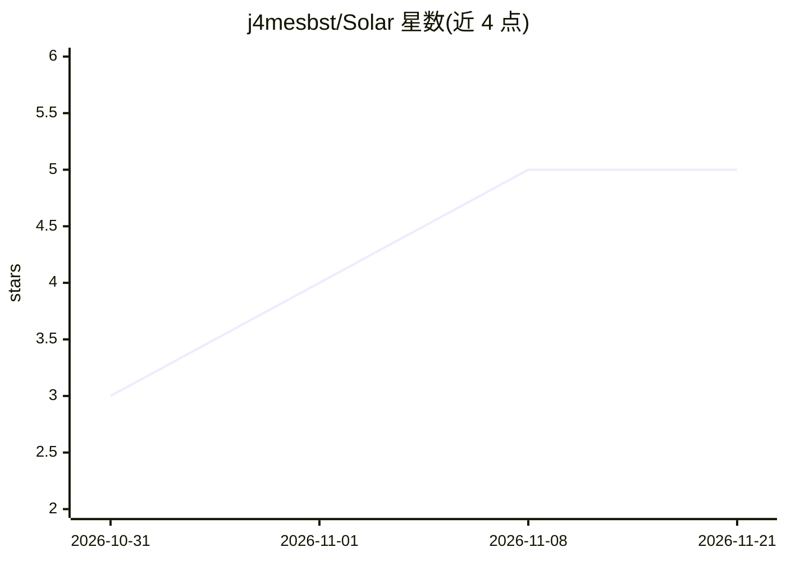

# j4mesbst/Solar

⭐ 5 · TypeScript · MIT · 推送 2026-11-09 · [GitHub](https://github.com/j4mesbst/Solar) · 个人维护

**macOS/Windows 上的本地 AI agent 团队聊天应用**

基于 Tauri、React 和 TypeScript 的开源桌面应用，用于创建可定制化身的 AI agent 并在原生消息界面中对话。每个 agent 保有独立的身份、会话与权限设置（只读/标准/完全访问）。模型可选 Ollama 本地推理、OpenCode 免费模型目录或自接兼容供应商；本地密钥在 macOS 上经 AES-256-GCM 加密存储。提供 Gmail、Google 日历、GitHub 等插件连接器，支持本地 Whisper 语音输入。当前版本 0.16.0。

## 筛选速览

| 维度 | 判定 | 备注 |
|---|---|---|
| AI 角色 | `ai-native` | 本体是模型或模型工具 |
| 许可风险 | `permissive` | MIT |
| 部署形态 | `desktop` | 安装包/桌面程序 |
| 模型依赖 | local-ok | 支持本地模型 |
| 硬件要求 | — | 无带数字的原话,不猜 |
| 安装摩擦 | `low` | 无编译、无系统依赖或容器化 |
| 成熟度 | — | 结构信号不足 |

## 能力要点

- 可创建多个定制化身的 agent，各自保留会话与显式权限
- 支持 Ollama 本地推理与 OpenCode 免费模型目录
- Gmail/Google 日历/GitHub 等应用连接器（部分需自配 OAuth 或 MCP）
- macOS 端密钥以 AES-256-GCM 本地加密存储，含本地 Whisper 语音输入

## 适用场景

- 在桌面上组建并管理一组各司其职的 AI agent 对话
- 通过 Ollama 本地模型离线使用，不消耗 API 额度
- 将邮箱、日历、GitHub 等服务接入 agent 工作流

## 场景标签

`聊天机器人` `AI 助手` · 领域:对话与助手

## 证据(README 行号)

> L23: Solar est une application open source construite avec Tauri, React et TypeScript. Créez vos agents, donnez-leur une
> L39: |**Modèle local**|Lancez Ollama, installez un modèle et laissez Solar le détecter. Aucun crédit API n’est nécessair

## 星数曲线

2026-10-31 3 → 2026-11-21 5（+2）

---
*卡片 v1 · prompt 1.4 · 生成 2026-11-21 · 置信度 high · 依据 README sha `b33df41ead3c` · [字段定义](../../DATASET.md)*
