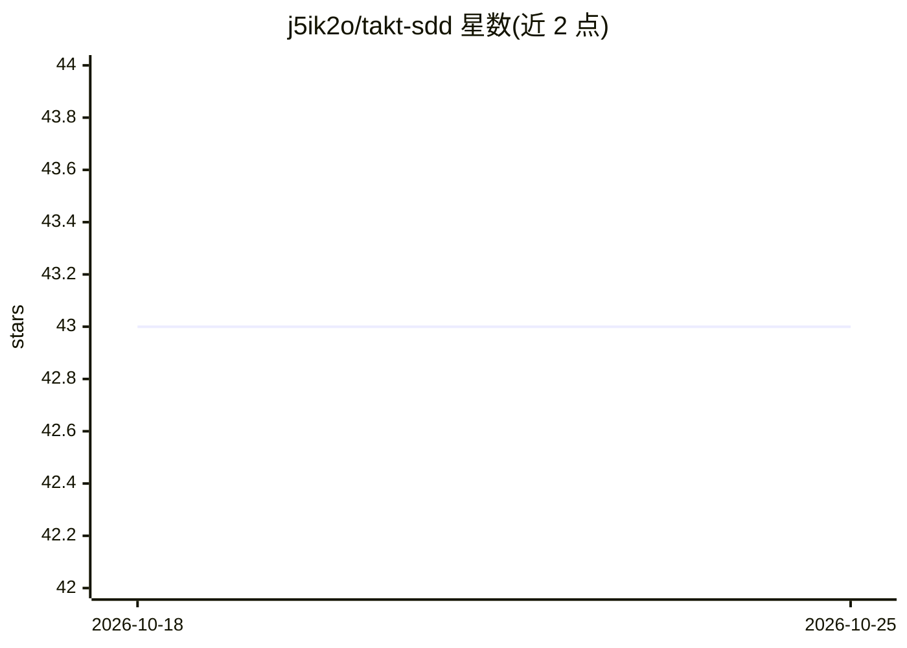

# j5ik2o/takt-sdd

⭐ 43 · JavaScript · Apache-2.0 · 推送 2026-10-24 · [GitHub](https://github.com/j5ik2o/takt-sdd) · 个人维护 · 中文 README

**基于 takt 的规格驱动开发（SDD）工作流定义库**

以 takt 状态机工作流（YAML）与 facets 驱动 AI agent 完成规格驱动开发全流程：需求定义（EARS 格式）、差距分析、技术设计、设计评审（GO/NO-GO）、任务分解、带 review/debug/verify 门禁的实现与实现验证。提示词拆分为 5 个可复用 facet；支持循环检测与监督介入、按任务依赖自适应串行/并行执行；provider 无关（如 Claude、Codex），输出兼容 Kiro（.kiro/specs/）。全局 npm CLI（takt-sdd kiro-*）运行，v2.0.0 已弃用 init/create-takt-sdd 资产复制与 cc-sdd-*/opsx-* 工作流。

## 筛选速览

| 维度 | 判定 | 备注 |
|---|---|---|
| AI 角色 | `ai-ecosystem` | LLM/agent 周边工具 |
| 许可风险 | `permissive` | Apache-2.0 |
| 部署形态 | `library` | 以包/库形式分发 |
| 模型依赖 | — | README 未给出锁定关系 |
| 硬件要求 | — | 无带数字的原话,不猜 |
| 安装摩擦 | `low` | 无编译、无系统依赖或容器化 |
| 成熟度 | — | 结构信号不足 |

## 能力要点

- 状态机式 YAML 工作流确定性控制 AI agent 执行顺序与条件
- 提示词按 5 关注点（Persona/Policy/Instruction/Knowledge/Output Contract）分 facet 复用
- 需求/设计/实现多阶段验证门禁与 GO/NO-GO 决策
- 循环检测与监督控制，依赖分析后并行执行独立任务

## 适用场景

- 在项目中以规格驱动方式让 AI agent 完成从需求到实现的全流程
- 用确定性工作流约束 AI agent 的非确定性输出
- 生成与 Kiro（.kiro/specs/）兼容的需求/设计/任务文档

## 场景标签

`工作流自动化` `提示工程` · 领域:Agent 开发

## 证据(README 行号)

> L25: takt-sdd uses takt's state-machine-based workflow control to deterministically manage AI agent execution paths.
> L27: - **Declarative Workflow Control** — Define AI agent execution order and transition conditions declaratively in wor
> L32: - **Provider Agnostic** — The same workflow definitions work across different providers such as Claude and Codex.

## 星数曲线

2026-10-18 43 → 2026-10-25 43（+0）

---
*卡片 v1 · prompt 1.4 · 生成 2026-10-25 · 置信度 high · 依据 README sha `eed80a179f00` · [字段定义](../../DATASET.md)*
