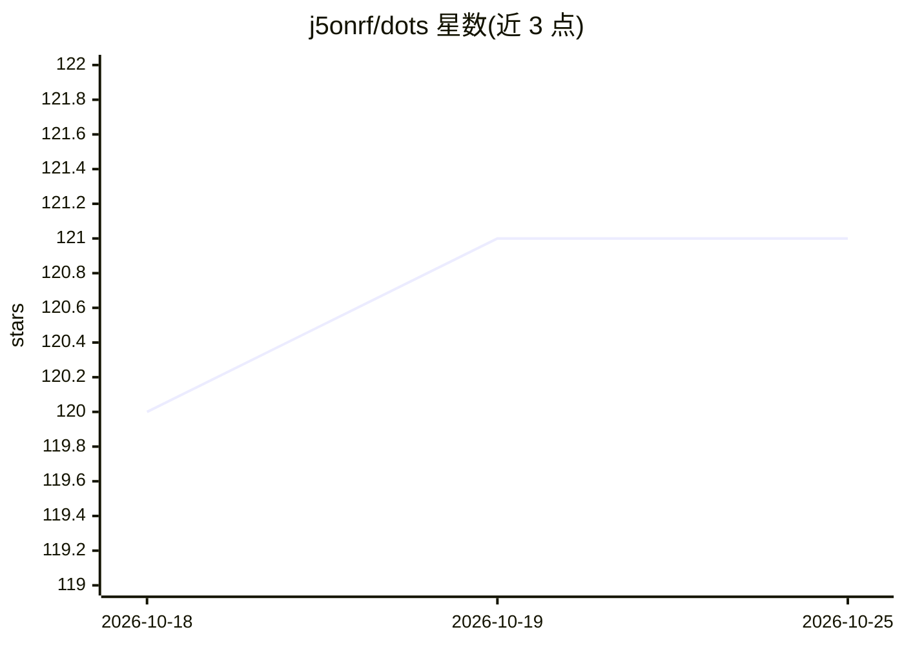

# j5onrf/dots

⭐ 121 · CSS · 推送 2026-10-25 · [GitHub](https://github.com/j5onrf/dots) · 个人维护

**Hyprland 桌面配置集：含 Waybar/Quickshell 主题与本地 AI 集成**

个人 Hyprland dotfiles 展示库，按时间线归档 Waybar、Quickshell（Noctalia/DankMaterialShell/Caelestia）、Omarchy 等多套桌面 shell 配置与主题（Nord、Catppuccin、Gruvbox、Everforest 等）。另含本地 AI 部分：在 Zed 编辑器中运行 Qwen3.6-35B-A3B 等 GGUF 量化模型、Py-Agent beta 与 AI Summary TUI。README 声明为定制集成，需用户自行适配系统，MIT 许可。

## 筛选速览

| 维度 | 判定 | 备注 |
|---|---|---|
| AI 角色 | `ai-enhanced` | 去掉 AI 部分产品仍成立 |
| 许可风险 | `none` | — |
| 部署形态 | `None` |  |
| 模型依赖 | — | README 未给出锁定关系 |
| 硬件要求 | — | 无带数字的原话,不猜 |
| 安装摩擦 | `low` | 无编译、无系统依赖或容器化 |
| 成熟度 | `idea` | |

## 能力要点

- 按年份归档的多套 Waybar/Quickshell/Omarchy 桌面配置与主题
- Zed 本地运行 Qwen3.6-35B-A3B（IQ4_NL GGUF）
- Py-Agent beta 与 AI Summary TUI 记录
- 含 Rofi/Kitty/字体/配色等周边配置展示

## 适用场景

- 参考 Hyprland 桌面 shell 配置与主题做法
- 了解本地 LLM 集成进桌面工作流的示例
- 挑选 Waybar/Rofi 样式用于自己的 dotfiles

## 场景标签

 · 领域:桌面环境/配置管理

## 证据(README 行号)

> L1: # Hyprdots
> L232: # Ai local-ai
> L382:  - These are custom integrated. Adapt to your system. MIT license

## 星数曲线

2026-10-18 120 → 2026-10-25 121（+1）

---
*卡片 v1 · prompt 1.4 · 生成 2026-10-23 · 置信度 mid · 依据 README sha `ff5a787fdc56` · [字段定义](../../DATASET.md)*
