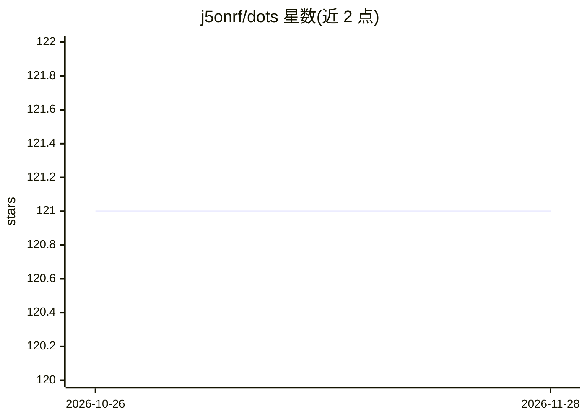

# j5onrf/dots

⭐ 121 · CSS · 推送 2026-11-21 · [GitHub](https://github.com/j5onrf/dots) · 个人维护

**面向 Hyprland 桌面用户的 dotfiles 配置与截图档案**

以截图档案为主的 Hyprland 桌面配置（dotfiles）仓库，按时间归档展示 Waybar、Quickshell、Noctalia/Caelestia/DankMaterialShell 等 shell 主题与 Rofi 配色方案，附字体、Matugen 配色、玻璃拟态布局等主题变体。含一节 local-ai 内容，展示 Qwen GGUF 模型在 Zed 中本地运行的截图与 Rs-Agent 预览。README 未提供安装脚本或命令，末尾注明需自行适配系统，采用 MIT 许可。

## 筛选速览

| 维度 | 判定 | 备注 |
|---|---|---|
| AI 角色 | `ai-enhanced` | 去掉 AI 部分产品仍成立 |
| 许可风险 | `none` | — |
| 部署形态 | `None` |  |
| 模型依赖 | — | README 未给出锁定关系 |
| 硬件要求 | — | 无带数字的原话,不猜 |
| 安装摩擦 | `low` | 无编译、无系统依赖或容器化 |
| 成熟度 | — | 结构信号不足 |

## 能力要点

- 按时间归档的 Hyprland/Waybar/Quickshell 主题截图集
- 包含 Rofi 配色方案与 Matugen 颜色模板等主题资产
- 收录 Noctalia/Caelestia/DankMaterialShell 等 Quickshell shell 配置
- 含 Qwen GGUF 本地模型运行截图与 Rs-Agent beta 预览

## 适用场景

- 参考 Hyprland 桌面的主题与布局设计
- 获取 Rofi 配色与 Waybar 模块配置灵感
- 查看本地 LLM 配合桌面环境的使用截图

## 场景标签

 · 领域:Linux 桌面配置/美化

## 证据(README 行号)

> L1: # Hyprdots
> L238: # Ai local-ai
> L383:  - These are custom integrated. Adapt to your system. MIT license

## 星数曲线

2026-10-26 121 → 2026-11-28 121（+0）

---
*卡片 v1 · prompt 1.4 · 生成 2026-11-28 · 置信度 mid · 依据 README sha `d74b60c9a616` · [字段定义](../../DATASET.md)*
