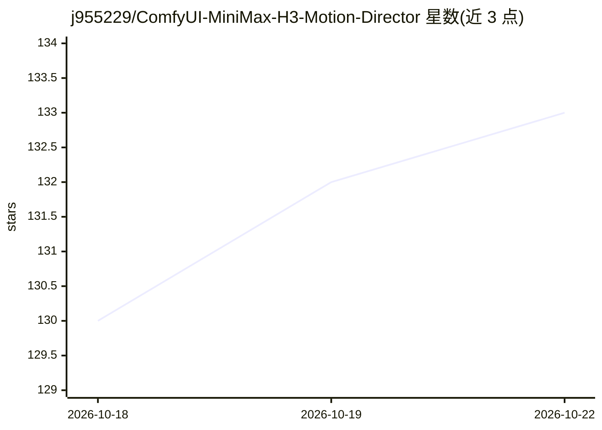

# j955229/ComfyUI-MiniMax-H3-Motion-Director

⭐ 133 · JavaScript · GPL-3.0 · 推送 2026-08-20 · [GitHub](https://github.com/j955229/ComfyUI-MiniMax-H3-Motion-Director) · 个人维护 · 中文 README

**ComfyUI 的 MiniMax H3 多段视频生成导演节点**

面向 ComfyUI 用户的自定义节点，将 MiniMax H3 的 T2V/I2V/FL2V/R2V/V2V/RV2V 六种生成模式整合到一个生产界面：Mixed Mode 时间线可逐段选择生成方式，跨段延续视觉与生成音频上下文，Selective Run 只重跑选中片段，另有 Source Bridge、素材库、公共参考、Global Refine/Face Refine 后处理、实时预览与结果分级导出。以 OUTPUT_NODE 形式暴露 images/audio/fps 供下游节点使用。要求较新的带官方 MiniMax H3 支持的 ComfyUI 构建，可选后处理（NVIDIA RTX VSR/Deblur、Face Refine）需额外运行时与模型依赖。

## 筛选速览

| 维度 | 判定 | 备注 |
|---|---|---|
| AI 角色 | `ai-ecosystem` | LLM/agent 周边工具 |
| 许可风险 | `viral` | GPL-3.0 |
| 部署形态 | `library` | 以包/库形式分发 |
| 模型依赖 | — | README 未给出锁定关系 |
| 硬件要求 | — | 无带数字的原话,不猜 |
| 安装摩擦 | `low` | 无编译、无系统依赖或容器化 |
| 成熟度 | — | 结构信号不足 |

## 能力要点

- Mixed Mode 时间线逐段混用 T2V/I2V/FL2V/R2V/Source Video
- 跨段视觉与生成音频延续（Motion Context、Color Re-anchor 等）
- Selective Run 仅重生成选中片段
- 内置 Material Library、Global Refine/Face Refine 后处理与实时预览

## 适用场景

- 在 ComfyUI 中制作多镜头长视频项目并保持段间连续性
- 只重跑需要修改的片段而不重跑整条序列
- 跨项目复用角色/场景/音频等参考素材

## 场景标签

`视频生成` · 领域:内容生成

## 证据(README 行号)

> L13: Build `T2V / I2V / FL2V / R2V / V2V / RV2V` shots in one production interface, mix generation methods segment by se
> L231: The repository exposes three Director-related nodes:

## 星数曲线

2026-10-18 130 → 2026-10-22 133（+3）

---
*卡片 v1 · prompt 1.4 · 生成 2026-10-22 · 置信度 mid · 依据 README sha `8e76f0e98f66` · [字段定义](../../DATASET.md)*
