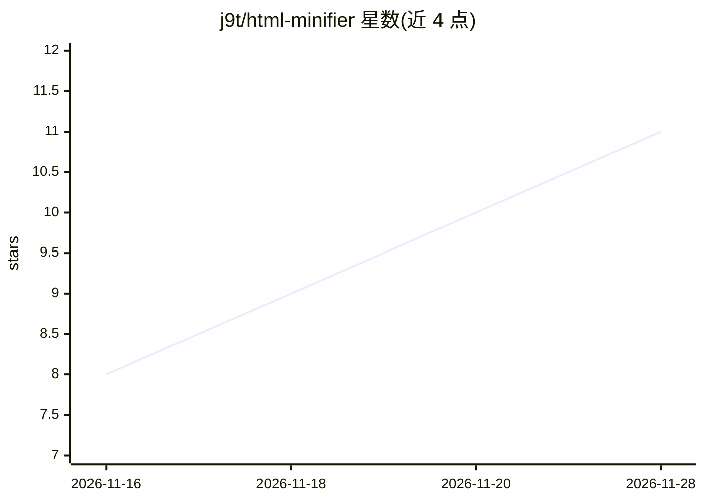

# j9t/html-minifier

⭐ 11 · JavaScript · MIT · 推送 2026-11-27 · [GitHub](https://github.com/j9t/html-minifier) · [官网](https://htmlminifier.org/) · 个人维护

**给前端开发者的可配置 HTML/CSS/JS/SVG 页面压缩工具**

以 JavaScript 编写的 HTML 压缩工具，同时处理文档内 CSS、JavaScript 与 SVG 的压缩。提供 CLI（npx 调用）与 Node.js API 两种使用方式，支持 conservative/comprehensive 预设、JSON 或 JS 模块配置文件、目录批量处理、worker 多线程与 dry-run 预览。要求 Node.js ≥22.13，仅支持 ESM（CommonJS 可通过动态 import 使用）。原作为 kangax 的 HTML Minifier，5 版起由 Jens Oliver Meiert 维护。

## 筛选速览

| 维度 | 判定 | 备注 |
|---|---|---|
| AI 角色 | `ai-enhanced` | 去掉 AI 部分产品仍成立 |
| 许可风险 | `permissive` | MIT |
| 部署形态 | `library` | 以包/库形式分发 |
| 模型依赖 | — | README 未给出锁定关系 |
| 硬件要求 | — | 无带数字的原话,不猜 |
| 安装摩擦 | `low` | 无编译、无系统依赖或容器化 |
| 成熟度 | — | 结构信号不足 |

## 能力要点

- CLI 与 Node.js API 双形式，支持管道与 STDIN/STDOUT
- conservative/comprehensive 预设加 JSON/JS 配置文件（含 JSON Schema 编辑器支持）
- 目录批量压缩，worker 线程数可调（默认半数核心，上限 6）
- 附配置向导 html-minifier-setup 与 --zero 零配置就地压缩

## 适用场景

- 发布前压缩静态站点 HTML 页面
- Astro/Eleventy/Jekyll/VitePress 构建流程中接入压缩
- 批量就地压缩目录下全部 HTML 文件并先预览结果

## 场景标签

 · 领域:Web 开发/前端优化工具

## 证据(README 行号)

> L5: Your web page optimization precision tool: HTML Minifier (HM) is a **highly effective, super-configurable, well-test
> L21: HTML Minifier is ESM-only and requires Node.js ≥22.13.

## 星数曲线

2026-11-16 8 → 2026-11-28 11（+3）

---
*卡片 v1 · prompt 1.4 · 生成 2026-11-20 · 置信度 high · 依据 README sha `804d3dcbc0b7` · [字段定义](../../DATASET.md)*
