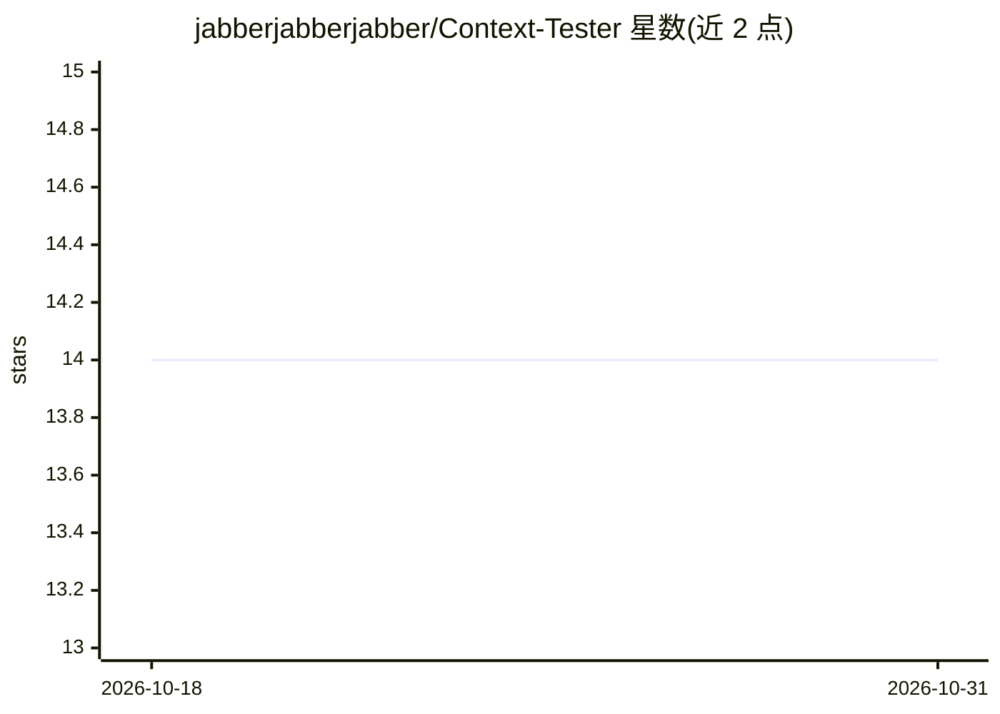

# jabberjabberjabber/Context-Tester

⭐ 14 · Python · MIT · 推送 2025-12-17 · [GitHub](https://github.com/jabberjabberjabber/Context-Tester) · 个人维护

**LLM 长上下文写作质量评测工具：填充上下文并续写打分**

面向 LLM 的评测工具：用长篇创作文本填充上下文窗口，让模型续写，从生成输出计算可读性、词汇多样性、重复率、熵与语义连贯等约 20 项指标，衡量输出质量随上下文长度的衰减。通过模型自身 tokenizer 切片保证同模型同长度的测试可直接比较，可用于测试不同 RoPE 值、量化与 KV cache 位数的影响。以 Python 脚本加 GUI 提供，git clone 后用 uv 安装运行，需 Python 3.13+ 和任意 OpenAI 兼容 API（含 embedding 端点）。

## 筛选速览

| 维度 | 判定 | 备注 |
|---|---|---|
| AI 角色 | `ai-ecosystem` | LLM/agent 周边工具 |
| 许可风险 | `permissive` | MIT |
| 部署形态 | `library` | 以包/库形式分发 |
| 模型依赖 | — | README 未给出锁定关系 |
| 硬件要求 | — | 无带数字的原话,不猜 |
| 安装摩擦 | `low` | 无编译、无系统依赖或容器化 |
| 成熟度 | `idea` | |

## 能力要点

- 长文本填充上下文并让模型续写的评测方法
- 约 20 项写作指标：可读性/词汇/句式/重复/熵/语义连贯
- 统一 tokenizer 接口：HuggingFace 为主，KoboldCpp、Tiktoken 兜底
- 支持测试不同 RoPE、量化与 KV cache 位数对输出的影响

## 适用场景

- 比较不同上下文长度下模型的写作质量衰减
- 调优 RoPE/量化参数时观察输出质量变化
- 跨模型、跨上下文窗口对比测试结果

## 场景标签

`模型评测` · 领域:评测与运维

## 证据(README 行号)

> L3: This tool utilizes a novel method for evaluating an LLM's writing ability.
> L40: 1. **Context Tester** (`benchmark_gui.py`) - Measures how LLM output quality degrades as context length increases

## 星数曲线

2026-10-18 14 → 2026-10-31 14（+0）

---
*卡片 v1 · prompt 1.4 · 生成 2026-10-31 · 置信度 mid · 依据 README sha `ac93be209e3e` · [字段定义](../../DATASET.md)*
