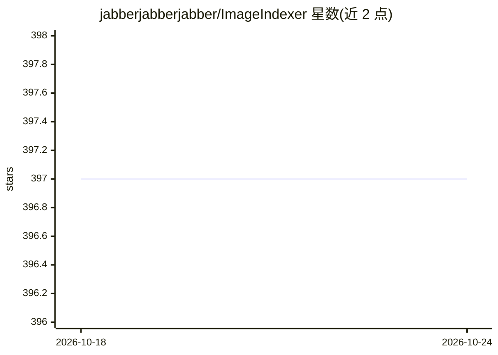

# jabberjabberjabber/ImageIndexer

⭐ 397 · Python · GPL-3.0 · 推送 2026-08-17 · [GitHub](https://github.com/jabberjabberjabber/ImageIndexer) · 个人维护

**本地视觉模型为图片生成关键词与说明并写入元数据**

LLMII 是一个本地运行的图像标注与索引工具：通过本机视觉语言模型为目录树中的每张图片生成关键词和说明文字，写入图片元数据或 XMP 边车文件，之后可用任何读取通用元数据字段的工具进行检索与组织。AI 后端依赖单可执行文件 KoboldCpp，首次运行可自动下载模型与依赖，支持 Apple Metal、Nvidia CUDA 与 AMD (Vulkan) 加速，可多次增量运行而不重复处理。提供 GUI 与跨平台启动脚本，可直接修改图片文件元数据（含原始相机格式），建议配备独立显卡。

## 筛选速览

| 维度 | 判定 | 备注 |
|---|---|---|
| AI 角色 | `ai-native` | 本体是模型或模型工具 |
| 许可风险 | `viral` | GPL-3.0 |
| 部署形态 | `None` |  |
| 模型依赖 | — | README 未给出锁定关系 |
| 硬件要求 | — | 无带数字的原话,不猜 |
| 安装摩擦 | `medium` | 含编译或系统依赖之一 |
| 成熟度 | — | 结构信号不足 |

## 能力要点

- 本地视觉模型生成关键词与说明并写入 MWG/XMP 元数据或 XMP 边车文件
- 支持 Apple Metal、Nvidia CUDA、AMD (Vulkan) 硬件加速
- KoboldCpp 后端自动下载配置，模型自动选择下载
- 通过 Identifier 标记跟踪处理状态，支持增量多次运行

## 适用场景

- 为本地图片库批量生成关键词与描述以便检索组织
- 在不上传云端的前提下为图片（含 RAW 格式）打标签
- 对已处理图片换模型重新补充关键词

## 场景标签

`图像视频处理` · 领域:感知与多模态

## 证据(README 行号)

> L3: LLMII uses a local AI to label metadata and index images. It does not rely on a cloud service or database.
> L5: A visual language model runs on your computer and is used to create captions and keywords for images in a directory 
> L13: - **Image Analysis**: Utilizes a local AI model to generate a list of keywords and a caption for each image

## 星数曲线

2026-10-18 397 → 2026-10-24 397（+0）

---
*卡片 v1 · prompt 1.4 · 生成 2026-10-22 · 置信度 high · 依据 README sha `6905d6f24bb2` · [字段定义](../../DATASET.md)*
