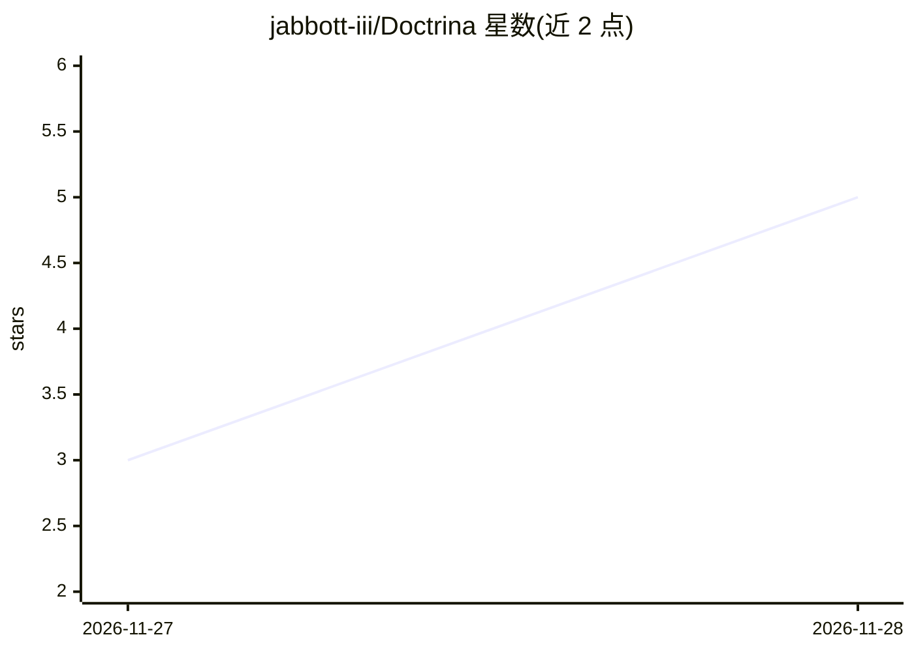

# jabbott-iii/Doctrina

⭐ 5 · Jupyter Notebook · MIT · 推送 2026-11-27 · [GitHub](https://github.com/jabbott-iii/Doctrina) · 个人维护

**面向 Claude Code 的跨仓库软件工程规则与技能合集**

该仓库汇集一组供 Claude Code 在多个仓库间共享的规则与技能文件。规则覆盖技术写作、前端与可访问性、提交信息规范、依赖策略、测试、结对编程，以及 Rust/Kotlin/Java/Python/TypeScript/Lua/Swift/Flutter 等语言的编码准则，另含项目规划文档与教学材料写作规则。技能提供四个斜杠命令：生成路线图与文档、按任务推进路线图、修正文档与代码漂移、绘制 Mermaid 架构图。规则采用仓库各自填入 Project details 的机制，技能依赖所采纳的规则。README 未给出安装命令。

## 筛选速览

| 维度 | 判定 | 备注 |
|---|---|---|
| AI 角色 | `ai-knowledge` | 知识聚合/清单类 |
| 许可风险 | `permissive` | MIT |
| 部署形态 | `library` | 以包/库形式分发 |
| 模型依赖 | — | README 未给出锁定关系 |
| 硬件要求 | — | 无带数字的原话,不猜 |
| 安装摩擦 | `low` | 无编译、无系统依赖或容器化 |
| 成熟度 | — | 结构信号不足 |

## 能力要点

- 跨仓库共享的 Claude Code 规则与技能文件集合
- 覆盖 9 种语言/平台编码规则与测试、依赖、安全等工程实践
- 4 个斜杠技能：生成路线图文档、逐任务推进、修复文档漂移、绘制架构图
- 规则通过 Project details 区块由各仓库按需填入差异化内容

## 适用场景

- 为采用 Claude Code 的多个仓库统一编码与提交规范
- 让 AI 按路线图逐任务推进开发并运行检查
- 生成并维护与代码一致的项目文档与架构图
- 编写课程与教学材料的结构化规则参考

## 场景标签

 · 领域:开发者工具/AI 辅助软件工程

## 证据(README 行号)

> L3: Doctrina holds Claude Code rules and skills that are shared across repositories. None names a
> L10: - `rules/writing.md`: spelling, grammar, numbers and units, technical writing

## 星数曲线

2026-11-27 3 → 2026-11-28 5（+2）

---
*卡片 v1 · prompt 1.4 · 生成 2026-11-27 · 置信度 mid · 依据 README sha `5f7f06aa15fe` · [字段定义](../../DATASET.md)*
