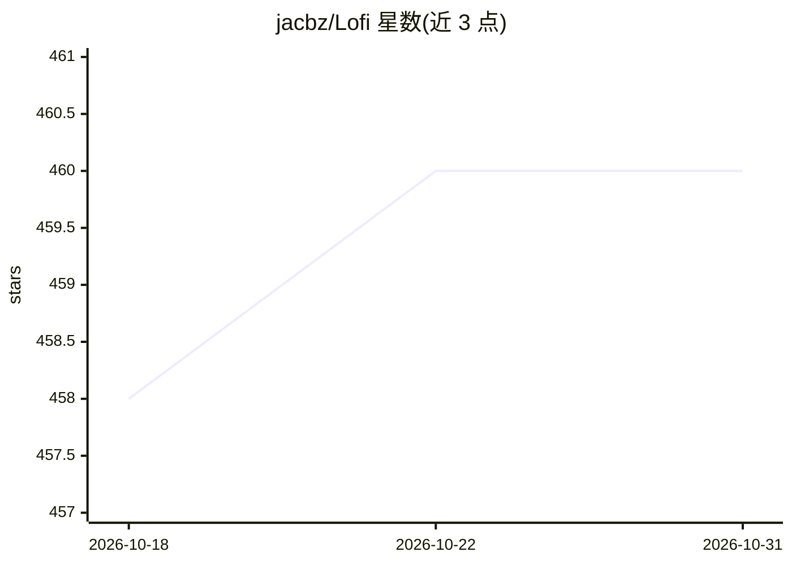

# jacbz/Lofi

⭐ 460 · TypeScript · Apache-2.0 · 推送 2026-08-24 · [GitHub](https://github.com/jacbz/Lofi) · [官网](https://lofi.jacobzhang.de/) · 个人维护

**面向听者的 lo-fi 音乐生成器：VAE 模型生成曲目参数**

基于机器学习的 lo-fi 音乐生成应用：用 PyTorch 训练 VAE 模型，将 lo-fi 曲目（和弦、旋律等音乐参数）表示为 100 维特征向量；Flask 服务端部署训练好的 checkpoint 并通过 REST API 提供服务，TypeScript 网页客户端用 Tone.js 根据参数合成音频。数据集由 Hooktheory 和 Spotify 等合成。用户可直接使用官方在线服务，也可本地训练模型并部署自己的服务器。

## 筛选速览

| 维度 | 判定 | 备注 |
|---|---|---|
| AI 角色 | `ai-native` | 本体是模型或模型工具 |
| 许可风险 | `permissive` | Apache-2.0 |
| 部署形态 | `self-host` | docker 或自建部署 |
| 模型依赖 | — | README 未给出锁定关系 |
| 硬件要求 | — | 无带数字的原话,不猜 |
| 安装摩擦 | `low` | 无编译、无系统依赖或容器化 |
| 成熟度 | — | 结构信号不足 |

## 能力要点

- PyTorch VAE 模型将曲目表示为 100 维特征向量
- Tone.js 网页客户端根据参数合成 lo-fi 音轨
- Flask 服务端通过 REST API 部署模型 checkpoint
- 提供预训练 checkpoint 下载与 Dockerfile

## 适用场景

- 在线生成 lo-fi 风格背景音乐
- 替换后端部署自己训练的模型
- 修改客户端与模型进行音乐生成实验

## 场景标签

 · 领域:音乐生成/Web 应用

## 证据(README 行号)

> L14:  A ML-supported lo-fi music generator.
> L19: We trained a VAE model in PyTorch to represent a lo-fi track as a vector of 100 features. A lo-fi track consists of

## 星数曲线

2026-10-18 458 → 2026-10-31 460（+2）

---
*卡片 v1 · prompt 1.4 · 生成 2026-10-21 · 置信度 high · 依据 README sha `23c3de6ee2d8` · [字段定义](../../DATASET.md)*
