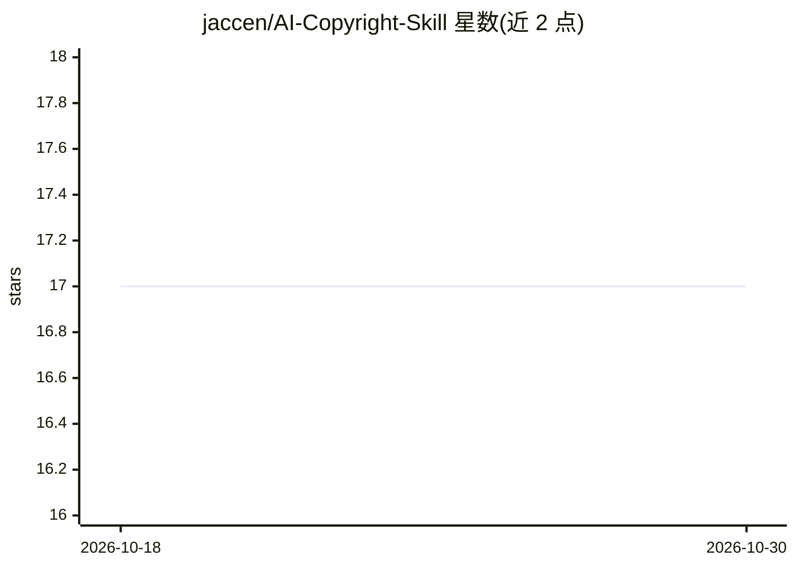

# jaccen/AI-Copyright-Skill

⭐ 17 · Python · MIT · 推送 2026-05-23 · [GitHub](https://github.com/jaccen/AI-Copyright-Skill) · 个人维护 · 中文 README

**面向 AI 项目的 Agent 知识产权技能：生成专利与软著文档**

一个安装到 Agent 框架（TeleAI Super Agent / OpenClaw / Claude Code）的 SKILL.md 技能：从 AI 项目代码、论文与设计文档出发，经专利性预评估、项目类型自动检测、多源现有技术检索（CNIPA/Google Patents/arXiv）等阶段流水线，生成中文发明专利申请、软著登记材料或技术交底书，默认直接输出 .docx 与 .pptx。内置 15 类权利要求模板、6+14+4 脱敏规则、100 分质量自检等知识库，覆盖 7 个 AI 领域 22 个子方向。以复制目录或 clawhub 命令安装。

## 筛选速览

| 维度 | 判定 | 备注 |
|---|---|---|
| AI 角色 | `ai-ecosystem` | LLM/agent 周边工具 |
| 许可风险 | `permissive` | MIT |
| 部署形态 | `library` | 以包/库形式分发 |
| 模型依赖 | — | README 未给出锁定关系 |
| 硬件要求 | — | 无带数字的原话,不猜 |
| 安装摩擦 | `medium` | 含编译或系统依赖之一 |
| 成熟度 | — | 结构信号不足 |

## 能力要点

- 三条输出路径：专利申请、软著登记、技术交底书
- 默认直接产出 .docx 与 .pptx（docx-js / PptxGenJS）
- 15 类权利要求模板与 7 AI 领域 x 22 子方向覆盖
- 多源现有技术检索（CNIPA 爬虫 + Google Patents API + arXiv）

## 适用场景

- 把 AI 项目代码或论文转成发明专利申请文档
- 为 AI 项目生成软著登记所需的说明书与源码文档
- 面向管理层或专利代理人快速产出技术交底书与汇报 PPT

## 场景标签

`AI 写作` · 领域:内容生成

## 证据(README 行号)

> L5: An Agent Skill that generates Chinese patent application documents, software copyright registration materials, and t
> L92: ├── SKILL.md                              # Main skill file (agent entry point)
> L101: Copy the entire `AI-Copyright-Skill/` directory to your skills folder:

## 星数曲线

2026-10-18 17 → 2026-10-30 17（+0）

---
*卡片 v1 · prompt 1.4 · 生成 2026-10-29 · 置信度 mid · 依据 README sha `d955728ecf39` · [字段定义](../../DATASET.md)*
