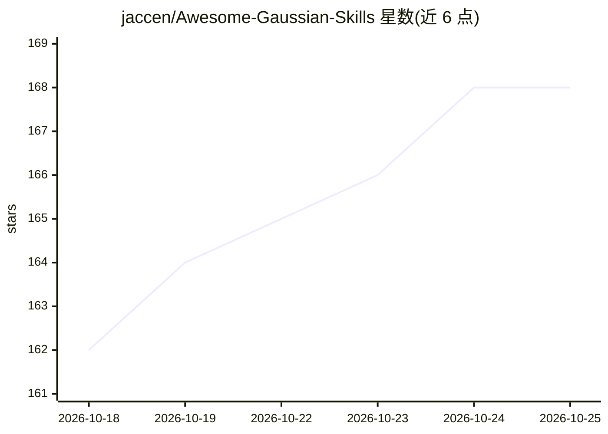

# jaccen/Awesome-Gaussian-Skills

⭐ 168 · TypeScript · Apache-2.0 · 推送 2026-10-24 · [GitHub](https://github.com/jaccen/Awesome-Gaussian-Skills) · [官网](https://jaccen.github.io/Awesome-Gaussian-Skills/) · 个人维护 · 中文 README

**3DGS 方法目录：976 篇 arXiv 验证论文 + 18 个 AI agent 技能 + MCP 服务器**

面向 3D Gaussian Splatting 研究者的知识库仓库：收录 976 个经 arXiv 核验的方法（26 个类别），提供可搜索的交互式方法浏览器，数据载体包括 methods.json/CSV/HTML 与摘要文件。知识以 18 个 SKILL.md 格式的 agent 技能（Claude Code 插件、DSH 插件）和一个含 34 个工具的 MCP 服务器（stdio, node 运行）分发，使 AI agent 可直接读取该知识库。另附带 13 章开源在线书籍，章节内容锚定仓库内的方法数据。收录采用 R9 协议（方法名须在论文标题/摘要中自述），并有全库审计与 arXiv-ID 复核记录。

## 筛选速览

| 维度 | 判定 | 备注 |
|---|---|---|
| AI 角色 | `ai-knowledge` | 知识聚合/清单类 |
| 许可风险 | `permissive` | Apache-2.0 |
| 部署形态 | `None` |  |
| 模型依赖 | — | README 未给出锁定关系 |
| 硬件要求 | — | 无带数字的原话,不猜 |
| 安装摩擦 | `medium` | 含编译或系统依赖之一 |
| 成熟度 | — | 结构信号不足 |

## 能力要点

- 976 个 arXiv 验证的 3DGS 方法，26 个类别组织
- 18 个 SKILL.md agent 技能 + 34 工具 MCP 服务器（21 核心 + 13 实验）
- 104 个已知 bug 模式检测与 10+ 维度方法自动比较
- 附 13 章开源书籍，章节内容锚定仓库方法数据

## 适用场景

- 查找并比较 3DGS 领域的方法与基线
- 让 Claude Code 或 MCP 客户端的 agent 读取该知识库辅助研究
- 按 NeRF→3DGS 迁移、实验设计等场景使用对应技能

## 场景标签

`精选清单` `科研工具` · 领域:学习与行业

## 证据(README 行号)

> L27: Other awesome lists give you paper titles. **We give you paper titles + an AI toolkit that makes you faster.** The 
> L7: ### The Most Comprehensive 3D Gaussian Splatting Catalog — 976 methods, 26 Categories, Interactive Explorer

## 星数曲线

2026-10-18 162 → 2026-10-25 168（+6）

---
*卡片 v1 · prompt 1.4 · 生成 2026-10-22 · 置信度 high · 依据 README sha `93ab98466f32` · [字段定义](../../DATASET.md)*
