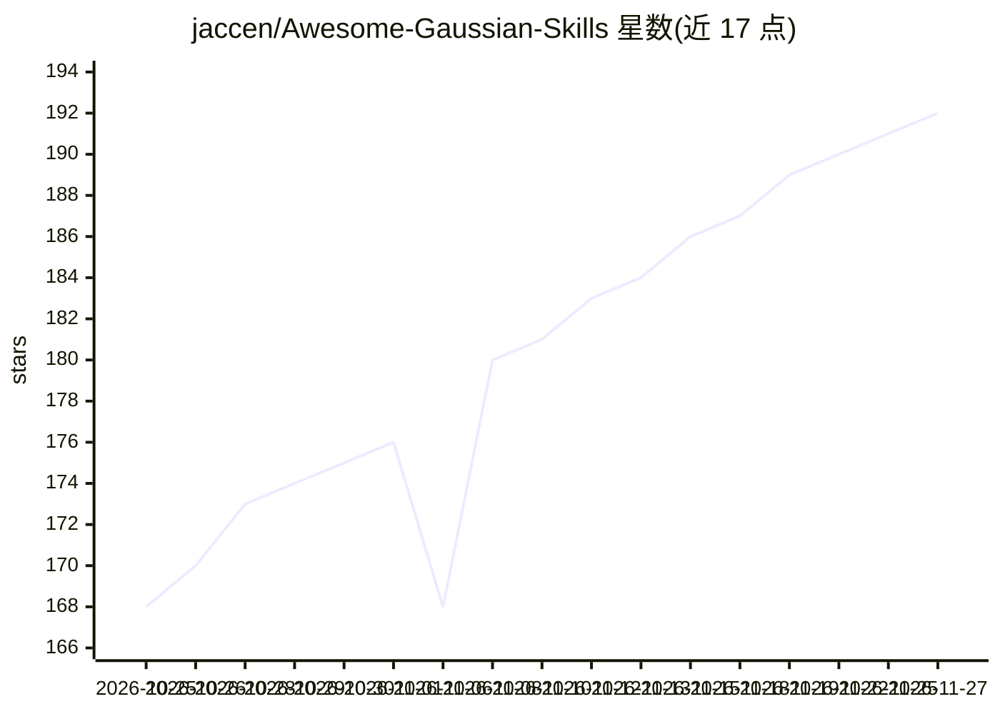

# jaccen/Awesome-Gaussian-Skills

⭐ 192 · HTML · Apache-2.0 · 推送 2026-11-26 · [GitHub](https://github.com/jaccen/Awesome-Gaussian-Skills) · [官网](https://jaccen.github.io/Awesome-Gaussian-Skills/) · 个人维护 · 中文 README

**面向 AI agent 的 3DGS 方法知识库与技能/MCP 工具集**

以 3D Gaussian Splatting 研究为主题的聚合仓库：收录 1085 条经 arXiv API 核验的方法条目，分 26 类，配交互式方法浏览器；同时打包 18 个 SKILL.md 格式的 agent 技能（3 个插件）和一个含 34 个工具的 MCP server，通过 Claude Code、DSH 等 agent 运行时加载使用。每周经官方 arXiv API 流水线增补与全库审计。附一本围绕 3DGS 的开源在线书，章节与仓库数据互相链接。知识库已在上海市知识产权管理部门完成数据产品知识产权登记。

## 筛选速览

| 维度 | 判定 | 备注 |
|---|---|---|
| AI 角色 | `ai-knowledge` | 知识聚合/清单类 |
| 许可风险 | `permissive` | Apache-2.0 |
| 部署形态 | `library` | 以包/库形式分发 |
| 模型依赖 | — | README 未给出锁定关系 |
| 硬件要求 | — | 无带数字的原话,不猜 |
| 安装摩擦 | `medium` | 含编译或系统依赖之一 |
| 成熟度 | — | 结构信号不足 |

## 能力要点

- 1085 条 arXiv 核验的 3DGS 方法，26 类组织，交互式浏览器检索/过滤/排序
- 18 个 agent 技能（SKILL.md）以 3 个插件分发，复制即用
- MCP server 暴露 34 个工具（21 核心 + 13 实验性），stdio 传输
- 每周 arXiv API 采集流水线：R1–R5 准入规则、逐条裁决与证据标记

## 适用场景

- 让 AI agent 帮我对比、检索 3DGS 论文方法
- 按会议定制实验方案、检测已知代码 bug 模式
- 写 3DGS 论文时用从选题到 rebuttal 的全流程技能
- 从 NeRF 或 CAD 迁移到 3DGS 时查迁移/转换指南

## 场景标签

`科研工具` `精选清单` · 领域:学习与行业

## 证据(README 行号)

> L5: ### The Most Comprehensive 3D Gaussian Splatting Catalog — 1085 methods, 26 Categories, Interactive Explorer
> L32: Other awesome lists give you paper titles. **We give you paper titles + an AI toolkit that makes you faster.** The 
> L68: This repo ships as both **AI agent skills** and an **MCP server**, so it works across agent runtimes and MCP client

## 星数曲线

2026-10-25 168 → 2026-11-27 192（+24）

---
*卡片 v1 · prompt 1.4 · 生成 2026-11-27 · 置信度 mid · 依据 README sha `137a4eb1e6d1` · [字段定义](../../DATASET.md)*
