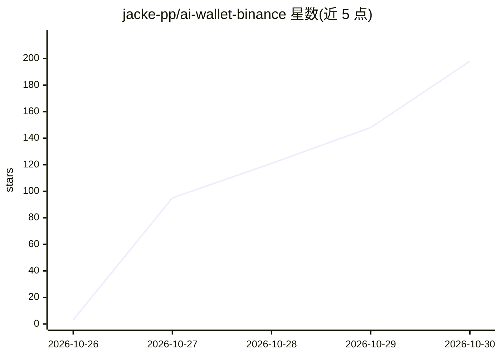

# jacke-pp/ai-wallet-binance

⭐ 198 · JavaScript · MIT · 推送 2026-10-26 · [GitHub](https://github.com/jacke-pp/ai-wallet-binance) · [官网](https://www.npmjs.com/package/ai-wallet-binance) · 个人维护 · 中文 README

**让 AI 通过币安 Agentic Wallet 代为链上交易的 CLI 工具**

运行在本机的命令行工具（aiwb），配合币安 App 开通 Agentic Wallet 后使用：AI（如 Claude、DeepSeek）按用户指令执行买卖、狙击 Four/Flap/GANG 发射台新币、Mint NFT、记账与转账等命令；私钥由币安保管，每笔交易经币安签名并受其风控检查。内置买前安全检测与链上模拟买卖实测税率，换币时在 PancakeSwap V2 与 KyberSwap 间比价路由。也可不经 AI，直接 `aiwb ui` 在本机浏览器页面手动交易。需 Node.js 18 以上。

## 筛选速览

| 维度 | 判定 | 备注 |
|---|---|---|
| AI 角色 | `ai-enhanced` | 去掉 AI 部分产品仍成立 |
| 许可风险 | `permissive` | MIT |
| 部署形态 | `library` | 以包/库形式分发 |
| 模型依赖 | — | README 未给出锁定关系 |
| 硬件要求 | — | 无带数字的原话,不猜 |
| 安装摩擦 | `low` | 无编译、无系统依赖或容器化 |
| 成熟度 | — | 结构信号不足 |

## 能力要点

- AI 通过命令行代为执行买卖/狙击/Mint/转账，私钥在币安、交易由币安签名
- 买前用自有钱包地址链上模拟买卖，实测隐藏税与可卖性
- 换币同时在 PancakeSwap V2 与 KyberSwap 报价，选到账更多路线
- `aiwb ui` 本机交易页面：三列新币看板、K 线、一键买卖与狙击

## 适用场景

- 用对话让 AI 用自己的币安 AI 钱包买币、卖币和狙击新币
- 在只有 AI 钱包能买的内盘/发射台抢 Agent 专属新币
- 不想打字时在本机浏览器页面手动点选交易

## 场景标签

`金融量化` · 领域:学习与行业

## 证据(README 行号)

> L5: 跟 Claude、Codex、DeepSeek 或 Grok 说一句“这个币买 0.05 BNB”，它就用你的币安 Agentic Wallet 去买，包括只有带
> L47: 也可以不用 AI，直接运行 `aiwb ui`：浏览器打开交易页面并显示二维码，用币安 App 扫码登录。页面只在你自己电脑上运行

## 星数曲线

2026-10-26 3 → 2026-10-30 198（+195）

---
*卡片 v1 · prompt 1.4 · 生成 2026-10-27 · 置信度 high · 依据 README sha `cdc99c3f884a` · [字段定义](../../DATASET.md)*
