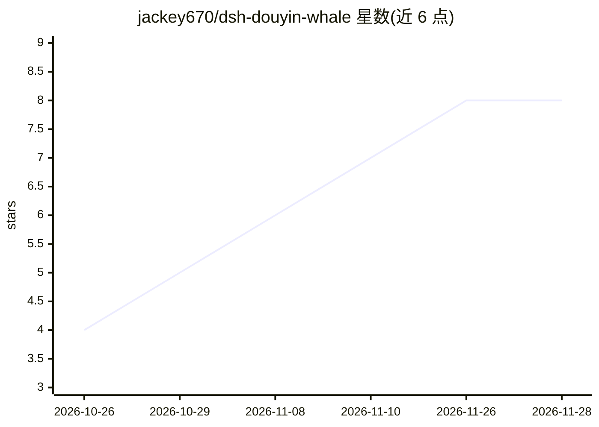

# jackey670/dsh-douyin-whale

⭐ 8 · JavaScript · MIT · 推送 2026-11-27 · [GitHub](https://github.com/jackey670/dsh-douyin-whale) · 个人维护 · 中文 README

**给 DSH agent 接入抖音的工具层：热榜/搜索/抽帧/私信**

一个 DSH Cordis 插件加一组可独立调用的 Python 脚本，把抖音热榜、搜索、视频详情、下载抽帧、网页版私信/群聊封装成工具和本地 HTTP API（127.0.0.1:7709）。抽帧后交视觉模型理解视频内容；写操作默认 dry-run 并设三道闸、配额与冷却。附定时调度器：只处理主人私信中的视频，唤醒 agent 看完写日记并回信，回读确认送达后才标记完成；带分层长期记忆与召回评测。不发布视频、不做养号与签名逆向。

## 筛选速览

| 维度 | 判定 | 备注 |
|---|---|---|
| AI 角色 | `ai-ecosystem` | LLM/agent 周边工具 |
| 许可风险 | `permissive` | MIT |
| 部署形态 | `desktop` | 安装包/桌面程序 |
| 模型依赖 | — | README 未给出锁定关系 |
| 硬件要求 | — | 无带数字的原话,不猜 |
| 安装摩擦 | `medium` | 含编译或系统依赖之一 |
| 成熟度 | — | 结构信号不足 |

## 能力要点

- ffmpeg 抽帧交视觉模型，视频理解无需自建
- Playwright 驱动网页版私信，dry-run 默认 + 三道闸 + 冷却与配额
- 本地分层长期记忆（情节/事实/叙事线/倒排索引，不依赖向量库）与召回评测
- 视频以原生分享卡片发送并回读确认送达

## 适用场景

- 让个人 agent 定时看主人发来的抖音视频并回信
- 通过本地 HTTP API 把抖音热榜/搜索能力接入任意程序
- 给自己的 agent 加视频抽帧理解与原生分享卡片发送能力

## 场景标签

`Agent 记忆` `浏览器自动化` `模型评测` `网页抓取` · 领域:Agent 开发

## 证据(README 行号)

> L24: 一个 **DSH 插件**（Cordis Host 插件，工具直接注册到 `ctx.tools`，不是 MCP
> L35: 4. **接得住**：所有能力都能通过本地 HTTP API（默认 `127.0.0.1:7709`）暴露，
> L205: `douyin-whale-duty-v2`，轮换后为 `douyin-whale-duty-eN`）：装载后 15 秒跑第一轮，

## 星数曲线

2026-10-26 4 → 2026-11-28 8（+4）

---
*卡片 v1 · prompt 1.4 · 生成 2026-11-20 · 置信度 mid · 依据 README sha `9da9b9d9155c` · [字段定义](../../DATASET.md)*
