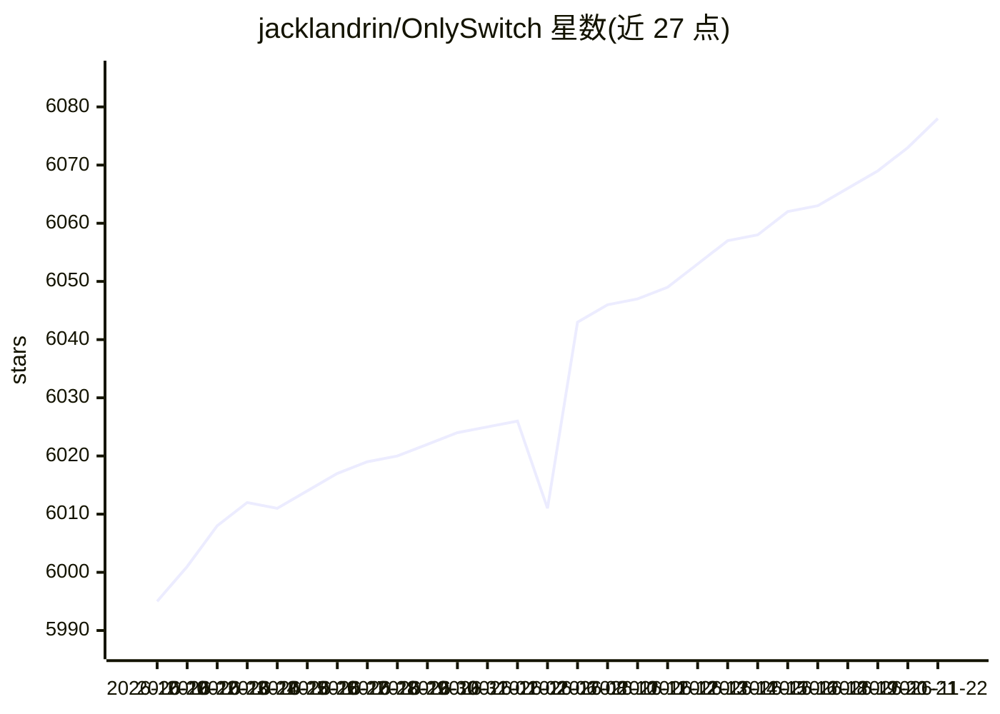

# jacklandrin/OnlySwitch

⭐ 6,078 · Swift · MIT · 推送 2026-11-18 · [GitHub](https://github.com/jacklandrin/OnlySwitch) · [官网](https://onlyswitch.click/) · 个人维护 · 中文 README

**macOS 菜单栏一体化控制工具，含 AI Agent 与桌面宠物**

将隐藏桌面图标、切换深色模式、保持唤醒、刘海管理等日常 macOS 控制集中到一个可自定义的菜单栏应用中，支持增删排序开关、快捷键、桌面小组件，并提供 iPhone/iPad 远程控制（OnlyRemote）。AI 相关功能包括：桌面宠物可在 Codex 或 Claude Code 工作时显示动画，可通过 Model Providers 所选模型按文字描述生成宠物皮肤。通过 Homebrew 或 DMG 安装。

## 筛选速览

| 维度 | 判定 | 备注 |
|---|---|---|
| AI 角色 | `ai-enhanced` | 去掉 AI 部分产品仍成立 |
| 许可风险 | `permissive` | MIT |
| 部署形态 | `None` |  |
| 模型依赖 | local-ok | 支持本地模型 |
| 硬件要求 | — | 无带数字的原话,不猜 |
| 安装摩擦 | `low` | 无编译、无系统依赖或容器化 |
| 成熟度 | — | 结构信号不足 |

## 能力要点

- 菜单栏一体化开关：深色模式、静音、保持唤醒、番茄钟等数十项内置开关
- OnlyRemote 从 iPhone/iPad 远程控制 Mac
- 桌面宠物支持 AI 生成皮肤，并可视化 Codex/Claude Code 工作状态
- Sound Mixer 按应用调音量、10 段 EQ 与多输出路由

## 适用场景

- 一键管理菜单栏里分散的 macOS 系统设置
- 让 AI 编码任务在桌面宠物上有可视化状态反馈
- 用文字描述生成个性化桌面宠物皮肤
- 在 iOS 设备上远程控制 Mac 的开关与控件

## 场景标签

 · 领域:系统工具/桌面效率

## 证据(README 行号)

> L13: OnlySwitch puts everyday macOS controls—such as hiding desktop icons, changing appearance, keeping the Mac awake, a
> L60: - Customize the optional Desktop Pet with AI-generated skins, feeding and petting, agent activity, and your choice 
> L72: Right-click the pet to feed or pet it. Hunger is cosmetic and can be turned off in settings. The pet also animates 

## 星数曲线

2026-10-20 5,995 → 2026-11-22 6,078（+83）

---
*卡片 v1 · prompt 1.4 · 生成 2026-11-22 · 置信度 high · 依据 README sha `47d8357cea0d` · [字段定义](../../DATASET.md)*
