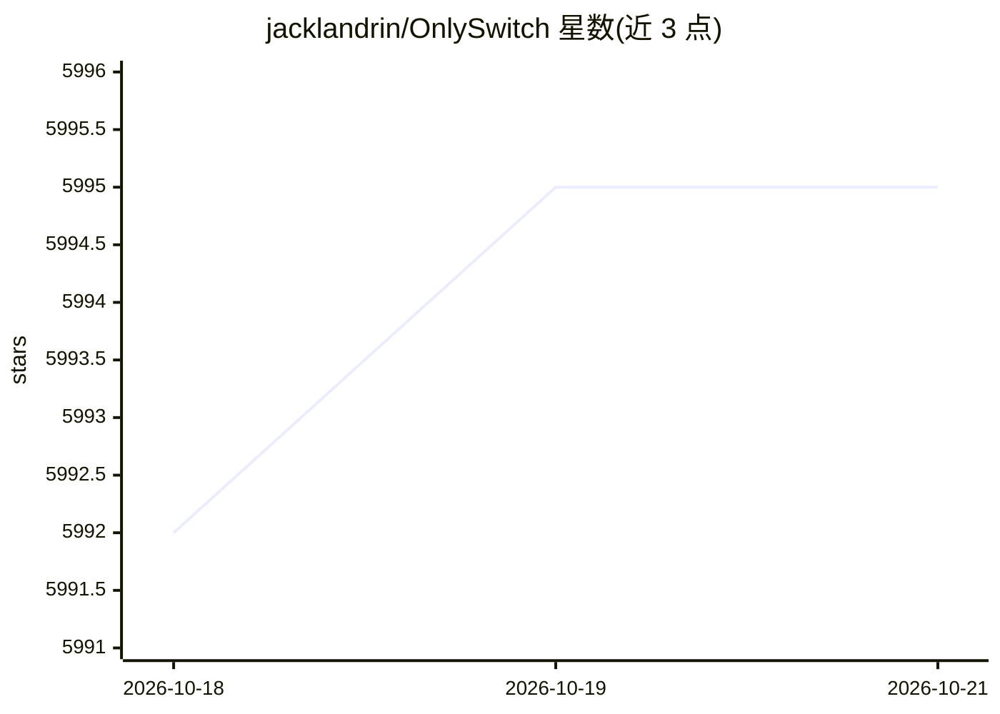

# jacklandrin/OnlySwitch

⭐ 5,995 · Swift · MIT · 推送 2026-10-19 · [GitHub](https://github.com/jacklandrin/OnlySwitch) · [官网](https://onlyswitch.click/) · 个人维护

**macOS 菜单栏多功能开关合集，含 AI Agent 与系统监视器**

面向 macOS 用户的一体化菜单栏应用：把隐藏桌面图标、深色模式、保持唤醒、刘海管理、番茄钟、AirPods 检测等数十种系统开关集中到一个可自定义的菜单栏界面，支持键盘快捷键、桌面小组件、iPhone/iPad 局域网远程控制。AI 相关功能包括：Only Agent（英文描述任务生成 AppleScript，支持 Ollama/OpenAI/Gemini）、Aphrodite（自然语言生成并运行迷你应用）、OpenClaw 自然语言触发开关。Aphrodite 与 Only Agent 需 macOS 26 或更高版本。

## 筛选速览

| 维度 | 判定 | 备注 |
|---|---|---|
| AI 角色 | `ai-enhanced` | 去掉 AI 部分产品仍成立 |
| 许可风险 | `permissive` | MIT |
| 部署形态 | `None` |  |
| 模型依赖 | local-ok | 支持本地模型 |
| 硬件要求 | — | 无带数字的原话,不猜 |
| 安装摩擦 | `low` | 无编译、无系统依赖或容器化 |
| 成熟度 | — | 结构信号不足 |

## 能力要点

- 数十种内置系统开关可添加、移除、排序并绑定快捷键
- Only Agent 生成 AppleScript 控制 Mac，支持 Ollama/OpenAI/Gemini
- Aphrodite 用自然语言生成、运行、分享迷你应用
- 系统监视器显示 CPU/GPU/内存/磁盘/网络实时用量与最繁忙进程
- Evolution 支持用 Shell/AppleScript 自建开关并通过画廊分享

## 适用场景

- 把常用的 macOS 系统设置切换集中到菜单栏一键操作
- 用英文描述任务让 AI 生成 AppleScript 自动操作 Mac
- 从 iPhone/iPad 远程控制 Mac 上的开关
- 在菜单栏或桌面小组件放常用控制

## 场景标签

`GUI 自动化` · 领域:效率与自动化

## 证据(README 行号)

> L11: OnlySwitch puts everyday macOS controls—such as hiding desktop icons, changing appearance, keeping the Mac awake, a
> L151: Only Agent lets you describe a task in English and generates AppleScript to control your Mac. When Agent mode is e

## 星数曲线

2026-10-18 5,992 → 2026-10-21 5,995（+3）

---
*卡片 v1 · prompt 1.4 · 生成 2026-10-20 · 置信度 high · 依据 README sha `17be37ed2c2d` · [字段定义](../../DATASET.md)*
