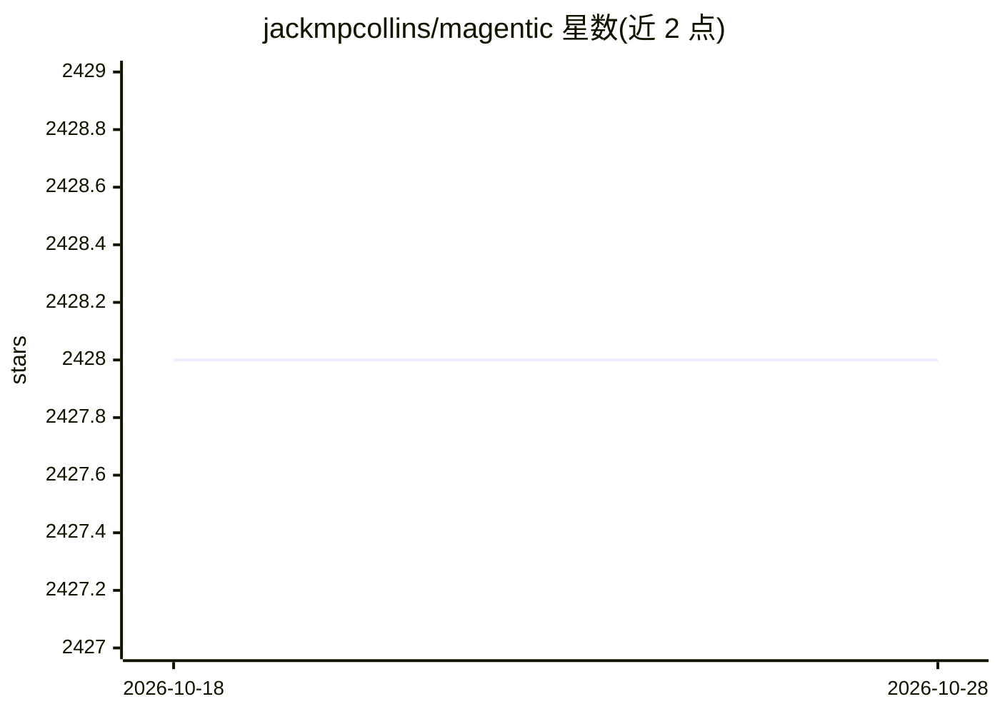

# jackmpcollins/magentic

⭐ 2,428 · Python · MIT · 推送 2026-03-11 · [GitHub](https://github.com/jackmpcollins/magentic) · [官网](https://magentic.dev/) · 个人维护

**将 LLM 集成为 Python 函数的装饰器框架**

通过 @prompt、@chatprompt、@prompt_chain 装饰器把 LLM 查询封装为带类型注解的 Python 函数，返回值遵守函数的返回类型标注（pydantic 模型或内置类型），支持结构化输出流式生成、FunctionCall 工具调用、异步并发查询与 OpenTelemetry 观测。后端支持 OpenAI（默认）、Anthropic、LiteLLM、Mistral，Ollama 可经 OpenAI 兼容 API 接入。面向在代码中构建 agentic 系统的 Python 开发者，以 pip 包分发。

## 筛选速览

| 维度 | 判定 | 备注 |
|---|---|---|
| AI 角色 | `ai-ecosystem` | LLM/agent 周边工具 |
| 许可风险 | `permissive` | MIT |
| 部署形态 | `library` | 以包/库形式分发 |
| 模型依赖 | local-ok | 支持本地模型 |
| 硬件要求 | — | 无带数字的原话,不猜 |
| 安装摩擦 | `low` | 无编译、无系统依赖或容器化 |
| 成熟度 | — | 结构信号不足 |

## 能力要点

- @prompt/@chatprompt 按函数返回类型注解生成结构化输出
- @prompt_chain 自动解析 FunctionCall 循环直至产出最终答案
- 结构化输出与函数调用支持流式生成
- 多后端支持：OpenAI/Anthropic/LiteLLM/Mistral，OpenTelemetry 观测

## 适用场景

- 在 Python 代码中以函数形式调用 LLM 并获得结构化结果
- 把 LLM 工具调用与传统 Python 函数组合构建 agent
- 并发/异步流式处理多个 LLM 生成任务

## 场景标签

`Agent 框架` · 领域:Agent 开发

## 证据(README 行号)

> L3: Seamlessly integrate Large Language Models into Python code. Use the `@prompt` and `@chatprompt` decorators to creat
> L146: Magentic supports multiple LLM providers or "backends". This roughly refers to which Python package is used to int

## 星数曲线

2026-10-18 2,428 → 2026-10-28 2,428（+0）

---
*卡片 v1 · prompt 1.4 · 生成 2026-10-21 · 置信度 high · 依据 README sha `bc70db9706e2` · [字段定义](../../DATASET.md)*
