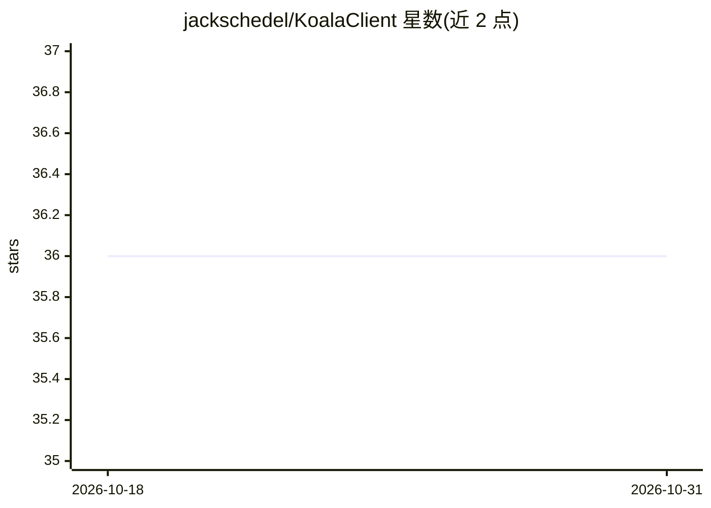

# jackschedel/KoalaClient

⭐ 36 · TypeScript · CC0-1.0 · 推送 2026-06-18 · [GitHub](https://github.com/jackschedel/KoalaClient) · 个人维护

**桌面优先的 OpenAI 兼容 API 聊天界面**

面向使用 OpenAI 兼容接口的用户界面：支持任意 OpenAI 兼容端点或适配服务（如 OpenRouter），可为不同模型配置多个端点，直接调节 Max Tokens、Max Context 等模型参数，并按模型自定义提示计价计算。功能包括 Whisper 语音转录、可搜索的提示词库、键盘快捷键与右键菜单等桌面化设计。README 未给出安装运行命令。

## 筛选速览

| 维度 | 判定 | 备注 |
|---|---|---|
| AI 角色 | `ai-native` | 本体是模型或模型工具 |
| 许可风险 | `viral` | CC0-1.0 |
| 部署形态 | `None` |  |
| 模型依赖 | — | README 未给出锁定关系 |
| 硬件要求 | — | 无带数字的原话,不猜 |
| 安装摩擦 | `low` | 无编译、无系统依赖或容器化 |
| 成熟度 | — | 结构信号不足 |

## 能力要点

- 支持任意 OpenAI 兼容端点，每模型可配多端点
- Whisper 语音转录与可搜索提示词库
- 按模型自定义提示计价计算
- 桌面优先设计：右键菜单、拼写检查、桌面键位绑定

## 适用场景

- 在统一界面中使用多个 OpenAI 兼容端点与模型
- 通过提示词库快速复用常用提示
- 在桌面工作流中配合快捷键使用 LLM 与语音转录

## 场景标签

`聊天机器人` `提示工程` `语音识别` · 领域:Agent 开发

## 证据(README 行号)

> L5:  OpenAI API user interface allowing seamless integration of generative AI into your workflow
> L37: - Use any OpenAI-compliant endpoint (or an adapter service like https://openrouter.ai/)

## 星数曲线

2026-10-18 36 → 2026-10-31 36（+0）

---
*卡片 v1 · prompt 1.4 · 生成 2026-10-25 · 置信度 mid · 依据 README sha `de43c4640cbb` · [字段定义](../../DATASET.md)*
