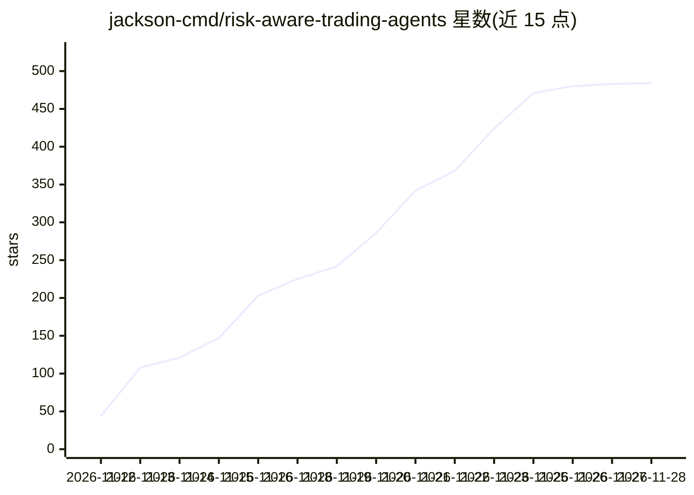

# jackson-cmd/risk-aware-trading-agents

⭐ 484 · Python · MIT · 推送 2026-11-26 · [GitHub](https://github.com/jackson-cmd/risk-aware-trading-agents) · [官网](https://jackson-cmd.github.io/risk-aware-trading-agents/) · 个人维护 · 中文 README

**面向美股交易者的风险感知 LLM 交易智能体与回测基准**

一个双重用途的 Python 包：既是 LLM 交易智能体公开基准（rta-bench-1 排行榜），也是一组美股交易 AI 智能体。基准侧提供 2020/2022/2026 三个冻结市场（价格、VIX、按发布分钟回放的新闻）、盲测模式与防未来函数检查；交易侧包含四类 agent 检查市场、日历、公司与新闻，确定性风控最终决定每笔订单，默认纸质交易、实盘需三次显式开关。支持 CLI、仪表盘、MCP 接入 Claude 等助手、Python API 四种使用方式，英文与中文双语，10 家券商。

## 筛选速览

| 维度 | 判定 | 备注 |
|---|---|---|
| AI 角色 | `ai-native` | 本体是模型或模型工具 |
| 许可风险 | `permissive` | MIT |
| 部署形态 | `self-host` | docker 或自建部署 |
| 模型依赖 | — | README 未给出锁定关系 |
| 硬件要求 | — | 无带数字的原话,不猜 |
| 安装摩擦 | `low` | 无编译、无系统依赖或容器化 |
| 成熟度 | — | 结构信号不足 |

## 能力要点

- 新闻按发布分钟回放、次日开盘成交的防未来函数回测，每次运行带 look-ahead 检查
- 公开 LLM 交易智能体排行榜 rta-bench-1，覆盖 2020/2022/2026 三个冻结市场
- 四类 agent + 确定性风控的组合：VIX 市况、FOMC/CPI 日历、30% 现金下限、交叉验证新闻
- 通过 MCP 接入 Claude/Codex/Gemini，用自然语言描述策略由 AI 写码回测

## 适用场景

- 在不能偷看未来的新闻回测中验证美股策略
- 研究并复现 LLM 交易智能体的表现并提交排行榜
- 先做纸质交易、每日与 SPY 对比后再考虑实盘
- 通过 Claude 等 MCP 客户端用自然语言测试自己的策略

## 场景标签

`金融量化` `模型评测` · 领域:评测与运维

## 证据(README 行号)

> L7: **The same package is also a set of AI trading agents for US stocks that check the macro calendar, the fear index an
> L89: Most trading bots either chase every signal or need a quant team to configure. This one follows a simple, explainab

## 星数曲线

2026-11-12 44 → 2026-11-28 484（+440）

---
*卡片 v1 · prompt 1.4 · 生成 2026-11-27 · 置信度 high · 依据 README sha `f54255b81a40` · [字段定义](../../DATASET.md)*
