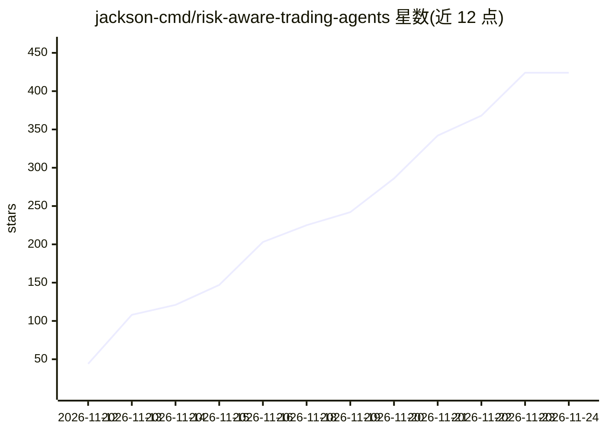

# jackson-cmd/risk-aware-trading-agents

⭐ 471 · Python · MIT · 推送 2026-11-20 · [GitHub](https://github.com/jackson-cmd/risk-aware-trading-agents) · [官网](https://jackson-cmd.github.io/risk-aware-trading-agents/) · 个人维护 · 中文 README

**美股 LLM 交易智能体基准与排行榜，附带可回测的交易智能体**

一个双重定位的项目：其一是 LLM 交易智能体的公开基准与排行榜（rta-bench-1），新闻按发布分钟重放、订单按次日开盘成交，提供 2020 崩盘、2022 熊市与 2026 三个冻结市场，每次运行做前视偏差检查；其二是面向美股的风险感知交易智能体，含 VIX/FOMC/CPI 宏观状态判断、30% 现金下限、模拟盘与实盘（10 家券商）、MCP server。授权新闻不再随包分发，需自带 SEC 8-K 或新闻 API。提供 pip、Docker 与 CLI/dashboard/Python 多种入口，中英双语。

## 筛选速览

| 维度 | 判定 | 备注 |
|---|---|---|
| AI 角色 | `ai-ecosystem` | LLM/agent 周边工具 |
| 许可风险 | `permissive` | MIT |
| 部署形态 | `self-host` | docker 或自建部署 |
| 模型依赖 | locked-api |  |
| 硬件要求 | — | 无带数字的原话,不猜 |
| 安装摩擦 | `low` | 无编译、无系统依赖或容器化 |
| 成熟度 | — | 结构信号不足 |

## 能力要点

- 新闻按发布分钟重放的回测与每次运行的前视偏差检查
- rta-bench-1 公开 LLM 交易智能体排行榜，三个冻结市场（2020/2022/2026）
- VIX/FOMC/CPI 驱动的四态市场状态与 30% 现金下限风控
- MCP server，Claude/Codex/Gemini 可代写并测试策略，无需 API key

## 适用场景

- 我用自然语言描述策略，让 Claude/Codex/Gemini 写成代码并回测
- 我在冻结的 2020/2022/2026 市场上评测和对比 LLM 交易智能体
- 我想先模拟盘跑交易智能体并按日与 SPY 对比排名

## 场景标签

`金融量化` `模型评测` · 领域:评测与运维

## 证据(README 行号)

> L1: Risk-Aware Trading Agents · 风险感知交易智能体: a benchmark and leaderboard for LLM trading agents with news replayed by the 
> L5: Most news backtests join headlines to prices by calendar date, so a headline published after the close is traded at 
> L63: - **0.8.0** · 🏆 **LLM trading agent leaderboard, rta-bench-1**: six models trade 2026, the 2022 bear market and the

## 星数曲线

2026-11-12 44 → 2026-11-24 424（+380）

---
*卡片 v1 · prompt 1.4 · 生成 2026-11-17 · 置信度 mid · 依据 README sha `31373c4cb2be` · [字段定义](../../DATASET.md)*
