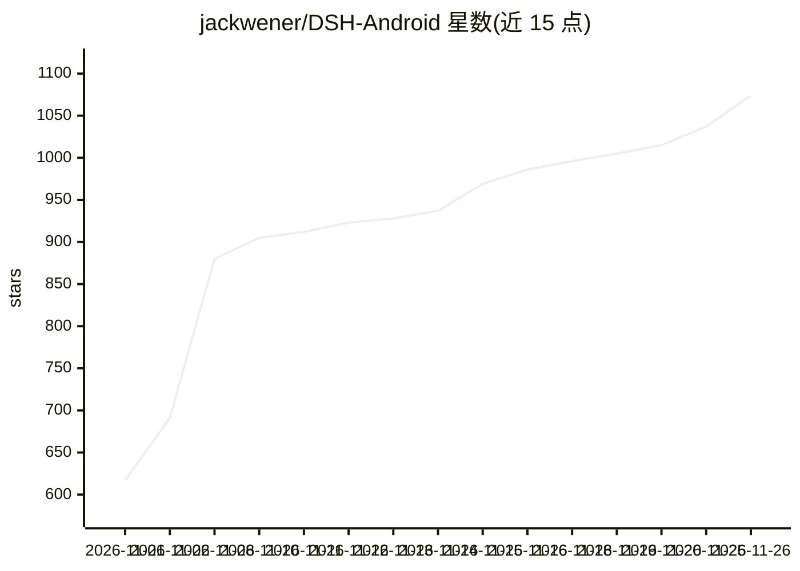

# jackwener/DSH-Android

⭐ 1,074 · Kotlin · Apache-2.0 · 推送 2026-11-24 · [GitHub](https://github.com/jackwener/DSH-Android) · 个人维护 · 中文 README

**免 ROOT 免 Termux 的安卓手机 Agent，运行 DeepSeek Harness**

在安卓手机上运行 DeepSeek Harness（dsh）的 App：引擎将 Node 24 编译为原生共享库嵌入 App 进程，通过无障碍服务读屏、点按、输入，执行文件整理、系统设置修改、定时/条件自动化等任务。用户登录 DeepSeek 账号或填 API key，也可添加 OpenAI 兼容接口的其他服务商。需要 Android 10+ 的 arm64 设备，APK 约 110 MB；锁屏时无法操作其他 App，引擎默认按需启停。提供 Releases 下载与源码构建两条路径。

## 筛选速览

| 维度 | 判定 | 备注 |
|---|---|---|
| AI 角色 | `ai-native` | 本体是模型或模型工具 |
| 许可风险 | `permissive` | Apache-2.0 |
| 部署形态 | `None` |  |
| 模型依赖 | locked-api |  |
| 硬件要求 | — | 无带数字的原话,不猜 |
| 安装摩擦 | `medium` | 含编译或系统依赖之一 |
| 成熟度 | — | 结构信号不足 |

## 能力要点

- 免 ROOT 免 Termux，单 APK 内嵌 Node 24 原生引擎（JNI 启动）
- 读屏、点按、输入操作手机 App，支持暂停/停止/插话与 Android 14+ 虚拟屏“不打扰模式”
- 支持 DeepSeek 官方及多家 OpenAI 兼容服务商，推理强度按模型记忆
- dsh 原样运行：技能、MCP、子 agent、网页搜索均可用

## 适用场景

- 让 Agent 用微信发消息、总结群聊或抓取内容
- 自动整理下载目录、批量处理手机里的文件
- 定时或按条件（连 Wi-Fi、充电、到位置）自动执行任务
- 通过 SSH/DSH Remote 出门时远程操控电脑上的 Agent

## 场景标签

`GUI 自动化` `AI 助手` `工作流自动化` · 领域:效率与自动化

## 证据(README 行号)

> L3: 不要 root，不用电脑，直接跑在你的安卓手机上。真正的手机 Agent，替你把手机上的事干完。
> L5: 在安卓手机上运行 DeepSeek Harness（dsh）：让它操作 App、整理文件、修改系统设置，或者自动执行任务。
> L54: - **引擎嵌在 App 进程里**：Node 24 编译成安卓原生的共享库，通过 JNI 在 `:engine` 前台服务中启动。不用 proot、不用 Termux，也不会碰到安卓 12 以后的“幽灵进程”限制。

## 星数曲线

2026-11-01 617 → 2026-11-26 1,074（+457）

---
*卡片 v1 · prompt 1.4 · 生成 2026-11-25 · 置信度 high · 依据 README sha `0ae3a5198e50` · [字段定义](../../DATASET.md)*
