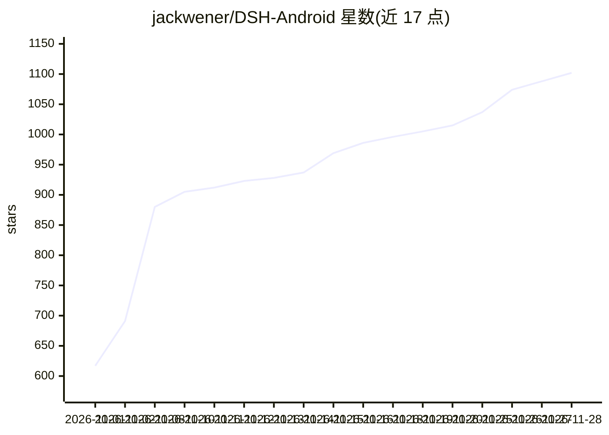

# jackwener/DSH-Android

⭐ 1,102 · Kotlin · Apache-2.0 · 推送 2026-11-24 · [GitHub](https://github.com/jackwener/DSH-Android) · 个人维护 · 中文 README

**免 ROOT 在安卓手机上运行 DeepSeek Harness 的手机 Agent App**

将 DeepSeek Harness（dsh）引擎以 Node 24 编译为安卓原生共享库、嵌入 App 进程运行的手机 Agent 应用。Agent 可通过无障碍服务读屏、点按、输入以操作其他 App，控制亮度、Wi‑Fi、通知等系统设置，执行定时/条件触发的自动化任务，并在内置 Linux 环境跑 Python 脚本。免 root、免 Termux，安装 APK 即用；Shizuku 或无线调试 ADB 为可选授权，可解锁虚拟屏等更多系统开关；也可通过 SSH 远程驱动电脑上的 dsh。社区项目，与 DeepSeek 官方无关联。

## 筛选速览

| 维度 | 判定 | 备注 |
|---|---|---|
| AI 角色 | `ai-native` | 本体是模型或模型工具 |
| 许可风险 | `permissive` | Apache-2.0 |
| 部署形态 | `library` | 以包/库形式分发 |
| 模型依赖 | locked-api |  |
| 硬件要求 | — | 无带数字的原话,不猜 |
| 安装摩擦 | `medium` | 含编译或系统依赖之一 |
| 成熟度 | — | 结构信号不足 |

## 能力要点

- 引擎嵌入 App 进程：Node 24 经 JNI 运行，不用 proot/Termux
- 基于无障碍服务的读屏、点击、输入，可操作微信、淘宝等 App
- 定时/条件自动化与内置 Linux 环境（跑 Python、处理文件）
- 支持 DeepSeek 账号/API key 及多家 OpenAI 兼容模型服务

## 适用场景

- 让 Agent 替我发微信消息、整理下载目录文件
- 到货提醒、连上 Wi‑Fi 后自动执行任务这类手机自动化
- 出门时通过手机远程操作电脑上的 dsh

## 场景标签

`AI 助手` `GUI 自动化` `工作流自动化` · 领域:效率与自动化

## 证据(README 行号)

> L3: 不要 root，不用电脑，直接跑在你的安卓手机上。真正的手机 Agent，替你把手机上的事干完。
> L5: 在安卓手机上运行 DeepSeek Harness（dsh）：让它操作 App、整理文件、修改系统设置，或者自动执行任务。
> L31: 2. 登录 DeepSeek 账号，或者填入 API key；也可以在 设置 → 模型服务 里添加其他服务商。

## 星数曲线

2026-11-01 617 → 2026-11-28 1,102（+485）

---
*卡片 v1 · prompt 1.4 · 生成 2026-11-26 · 置信度 mid · 依据 README sha `68377dd77336` · [字段定义](../../DATASET.md)*
