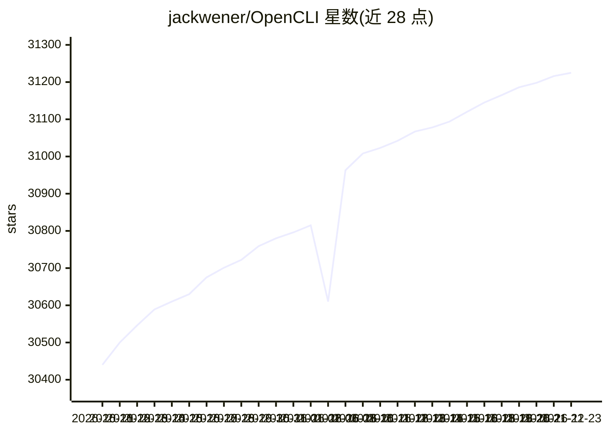

# jackwener/OpenCLI

⭐ 31,225 · JavaScript · Apache-2.0 · 推送 2026-11-07 · [GitHub](https://github.com/jackwener/OpenCLI) · [官网](https://opencli.info/) · 个人维护 · 中文 README

**把任意网站转成 CLI 命令、供 AI agent 操控已登录浏览器**

OpenCLI 是面向 AI agent 与人类用户的浏览器自动化 CLI：无需站点适配器即可导航、点击、填表、提取、截图；内置 Bilibili、知乎、Reddit 等站点适配器提供确定性命令。命令默认输出 JSON（stdout 结果、stderr 日志、非零退出码）。通过 Browser Bridge Chrome 扩展加本地守护进程连接用户已登录的浏览器；提供 opencli-browser、opencli-adapter-author、opencli-autofix、opencli-usage 四个可装入 Claude Code/Cursor 等 agent 的技能。桌面端提供 OpenCLIApp 安装包，CLI/服务器场景走 npm 安装。

## 筛选速览

| 维度 | 判定 | 备注 |
|---|---|---|
| AI 角色 | `ai-ecosystem` | LLM/agent 周边工具 |
| 许可风险 | `permissive` | Apache-2.0 |
| 部署形态 | `desktop` | 安装包/桌面程序 |
| 模型依赖 | — | README 未给出锁定关系 |
| 硬件要求 | — | 无带数字的原话,不猜 |
| 安装摩擦 | `low` | 无编译、无系统依赖或容器化 |
| 成熟度 | — | 结构信号不足 |

## 动量与使用信号

- 维护:`active` — 距上次 push 0.8 天,年发版 100,252 位贡献者
- 涨星:近 1 天 **+46**(自 20261016 起算)
- 安装:npm 包 `@jackwener/opencli` 月下载 87,363
- 平台:WINDOWS / MACOS · 协议:—

## 能力要点

- 内置多站点适配器（Bilibili/知乎/小红书/Reddit/HackerNews 等）提供确定性命令
- opencli-browser 技能让 agent 通过已登录 Chrome 执行导航/点击/填表/提取
- 结构化 DOM 快照读取页面内容（非截图），支持网络 API 响应拦截
- 适配器编写全流程：recon→discover→auth→decode→test，站点知识持久化到 ~/.opencli/sites/

## 适用场景

- 让 Claude Code/Cursor 等 agent 代我操作已登录的网站（查通知、填表单）
- 用命令行代替浏览器会话抓取站点数据
- 为新站点编写可复用的适配器命令

## 场景标签

`浏览器自动化` · 领域:效率与自动化

## 证据(README 行号)

> L13: OpenCLI is a **general-purpose browser automation CLI for AI agents** and an **agent-browser alternative**. Navigat
> L18: - **Let AI Agents operate any website** — install the `opencli-browser` skill in your AI agent (Claude Code, Cursor
> L149: OpenCLI's browser commands are designed to be used by AI Agents — not run manually. Install skills into your AI ag

## 星数曲线

2026-10-21 30,440 → 2026-11-23 31,225（+785）

---
*卡片 v1 · prompt 1.4 · 生成 2026-11-22 · 置信度 high · 依据 README sha `5a618c671c87` · [字段定义](../../DATASET.md)*
