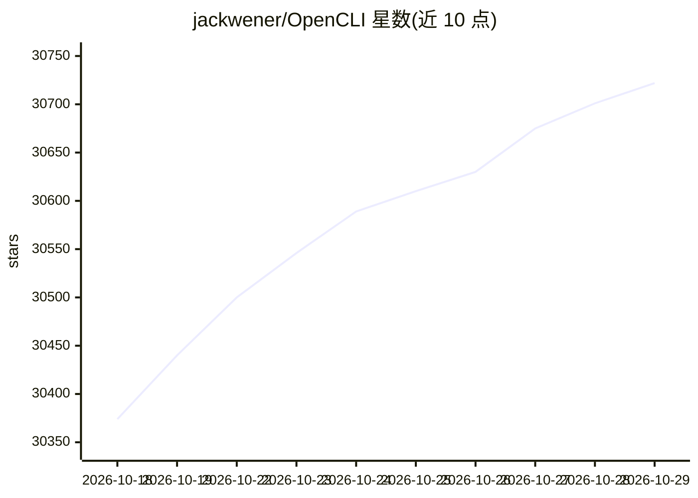

# jackwener/OpenCLI

⭐ 30,722 · JavaScript · Apache-2.0 · 推送 2026-10-26 · [GitHub](https://github.com/jackwener/OpenCLI) · [官网](https://opencli.info/) · 个人维护 · 中文 README

**把任意网站变成 CLI 命令、供 AI agent 操作登录态浏览器的工具**

OpenCLI 是面向 AI agent 的通用浏览器自动化 CLI，同时自称 agent-browser 的一款替代工具。它通过 Browser Bridge 扩展与本地守护进程连接用户已登录的 Chrome/Chromium，无需站点适配器即可导航、点击、填表、提取与截图；内置 Bilibili、知乎、Reddit、HackerNews 等站点适配器提供确定性命令。所有命令默认输出 JSON 并配退出码约定，便于 agent 消费。安装方式包括 macOS/Windows 桌面应用 OpenCLIApp 和 npm 全局安装（需 Node.js ≥ 20.18.1），并通过 npx skills 向 Claude Code、Cursor 等 agent 安装四个技能。

## 筛选速览

| 维度 | 判定 | 备注 |
|---|---|---|
| AI 角色 | `ai-ecosystem` | LLM/agent 周边工具 |
| 许可风险 | `permissive` | Apache-2.0 |
| 部署形态 | `desktop` | 安装包/桌面程序 |
| 模型依赖 | — | README 未给出锁定关系 |
| 硬件要求 | — | 无带数字的原话,不猜 |
| 安装摩擦 | `low` | 无编译、无系统依赖或容器化 |
| 成熟度 | — | 结构信号不足 |

## 动量与使用信号

- 维护:`active` — 距上次 push 0.8 天,年发版 100,252 位贡献者
- 涨星:近 1 天 **+46**(自 20261016 起算)
- 安装:npm 包 `@jackwener/opencli` 月下载 87,363
- 平台:WINDOWS / MACOS · 协议:—

## 能力要点

- 内置 Bilibili、知乎、小红书、Reddit 等站点适配器，提供确定性 CLI 命令
- 命令默认 JSON 输出（ok/data/error 结构）并配非零退出码约定
- 四个可安装技能：opencli-browser、adapter-author、autofix、usage
- 支持多 Chrome profile 别名管理与 --session 页面会话路由

## 适用场景

- 让 AI agent 借用我的登录态浏览器抓取页面或填写表单
- 为无 API 的网站编写可复用的命令行适配器
- 在 CI/服务器环境用 npm 安装 CLI 做确定性网页自动化

## 场景标签

`浏览器自动化` `网页抓取` · 领域:效率与自动化

## 证据(README 行号)

> L12: OpenCLI is a **general-purpose browser automation CLI for AI agents** and an **agent-browser alternative**. Navigat
> L17: - **Let AI Agents operate any website** — install the `opencli-browser` skill in your AI agent (Claude Code, Cursor
> L60: npm install -g @jackwener/opencli

## 星数曲线

2026-10-18 30,374 → 2026-10-29 30,722（+348）

---
*卡片 v1 · prompt 1.4 · 生成 2026-10-18 · 置信度 high · 依据 README sha `1077897fe034` · [字段定义](../../DATASET.md)*
