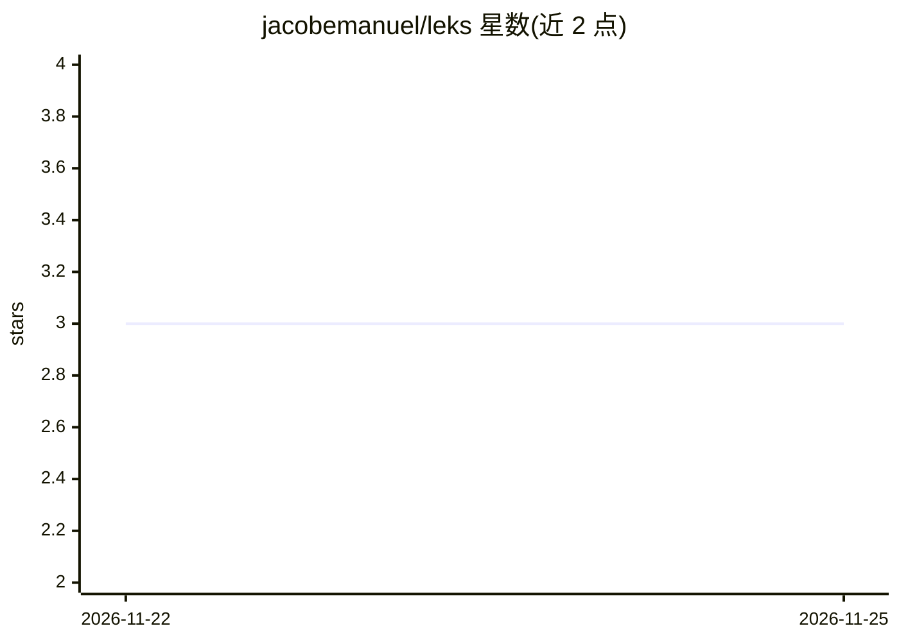

# jacobemanuel/leks

⭐ 3 · Python · MIT · 推送 2026-11-15 · [GitHub](https://github.com/jacobemanuel/leks) · [官网](https://majewski.studio) · 个人维护

**给编码 agent 的本地搜索服务器：带出处与时效状态检索笔记**

LEKS 是运行在本机的 MCP 搜索服务器：索引项目里的笔记、决策记录、规格、PDF、Word 与代码，Claude Code、GitHub Copilot 或 Codex 以自然语言提问，得到带文件与行号引用的段落。关键机制包括词法与语义多路检索加本地重排、读取 superseded_by 前置信息使新决策排在被替代决策之上、只返回引用文本而不自行生成。需要 Python 3.10+（模型路径需 3.11+），索引与模型均留在本机，无 API key 与云端调用；README 中的准确率与成本数据来自作者自测，未见第三方验证。

## 筛选速览

| 维度 | 判定 | 备注 |
|---|---|---|
| AI 角色 | `ai-ecosystem` | LLM/agent 周边工具 |
| 许可风险 | `permissive` | MIT |
| 部署形态 | `library` | 以包/库形式分发 |
| 模型依赖 | — | README 未给出锁定关系 |
| 硬件要求 | — | 无带数字的原话,不猜 |
| 安装摩擦 | `low` | 无编译、无系统依赖或容器化 |
| 成熟度 | — | 结构信号不足 |

## 能力要点

- 词法多路与语义路并行检索，重排融合最优 40 条
- 读取 superseded_by 标记，被替代决策排在新决策之后
- 七个 MCP 工具：search/read/locate/tried/neighbours/state/status
- 全部索引与模型留在本机，macOS 上模型进程在无网络沙箱运行

## 适用场景

- 让 Claude Code 等编码 agent 直接引用本地笔记与 ADR 回答问题
- 长周期项目中避免 agent 基于已被替代的旧决策构建
- 检索 PDF、Word 与代码中带页码/行号出处的内容

## 场景标签

`语义搜索` · 领域:知识与检索

## 证据(README 行号)

> L7:  Your notes, decisions, PDFs, Word files and code, indexed on your own machine. Claude Code, GitHub Copilot or Codex
> L12:  MCP server for Claude Code, GitHub Copilot and Codex
> L18: A search server for coding agents that runs on your own machine. It indexes the notes, decisions, specs, PDFs, Word

## 星数曲线

2026-11-22 3 → 2026-11-25 3（+0）

---
*卡片 v1 · prompt 1.4 · 生成 2026-11-22 · 置信度 high · 依据 README sha `f6afa4f3efb9` · [字段定义](../../DATASET.md)*
